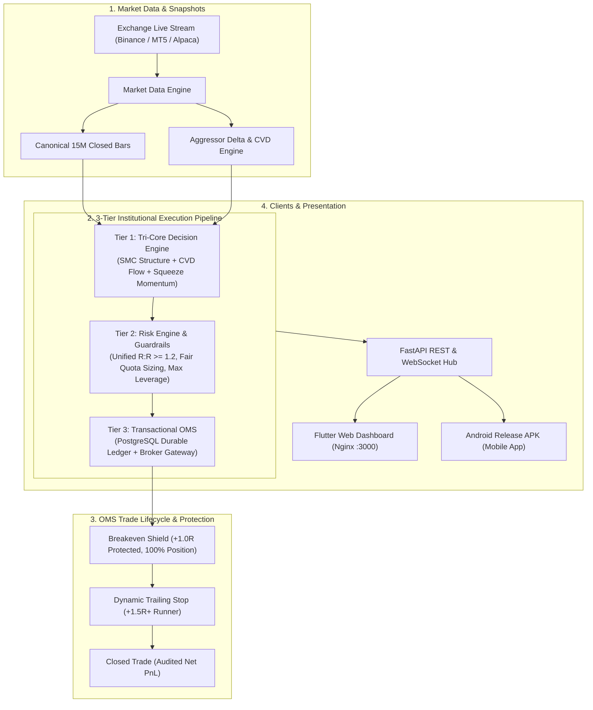
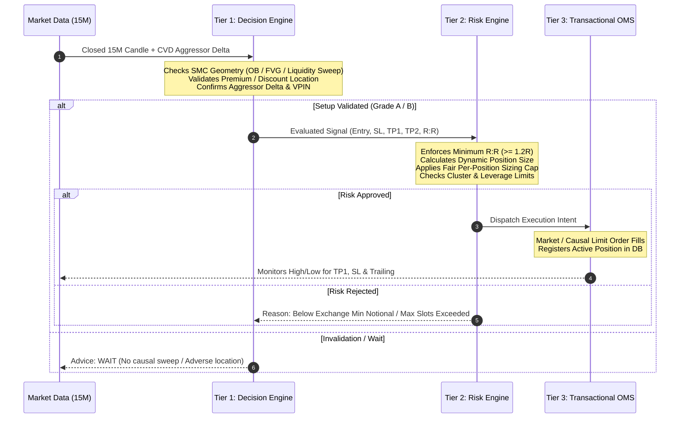

# AI Trade Advisor & Autonomous Execution Platform

> **Institutional-Grade Rule-Based & Advisory AI Trading System**  
> Operating on Deterministic Core Authorities, Canonical 15M Snapshots, Multi-bar Orderflow (SMC + CVD), 3-Tier Autonomous Execution Pipeline, and Real-Time Risk Guardrails.

---

## 🏛️ System Architecture

The platform is designed with strict **Authority Boundaries** separating Market Analysis, Decision Making, Risk Management, and Order Execution:



---

## ⚡ 3-Tier Execution Pipeline Overview



---

## 🌟 Key Features & Functional Modules

### 1. 🔍 Proactive SMC Scanner
* **Multi-Asset Watchlist**: Scans Crypto (Binance Futures), Forex & Gold (MT5), and US Equities (Alpaca).
* **Execution Timeframe (`15M`) with Multi-Timeframe Context (`1H / 4H`)**: Higher timeframes provide structural bias (Market Regime, Trend Persistence), while entry triggers bind strictly to the closed 15M candle to prevent intrabar repainting.
* **Institutional Location Guard**: Automatically detects Discount vs. Premium zones. Unconditionally blocks buying in Premium or shorting in Discount.
* **Orderflow & CVD Evidence**: Evaluates Cumulative Volume Delta (CVD) divergence, absorption, and VPIN toxicity before approving setups.

### 2. 🧠 Tri-Core Decision Engine (Tier 1)
* **Deterministic Setup Identification**:
  * **Displacement-Retest**: Confirms aggressive institutional momentum breaking structure (`BOS`/`CHoCH`), waiting for the first retest into Order Blocks (`+OB`/`-OB`) or Fair Value Gaps (`FVG`).
  * **Causal Liquidity Sweep**: Identifies stops swept at `Strong Low` or `Strong High` followed by instant CVD absorption.
* **Setup Grading**: Ranks setups (`Grade A`, `Grade B`, or `WATCH`). Only qualifying grades proceed to execution.

### 3. 🛡️ Risk Engine with Max Leverage & Fair Quota (Tier 2)
* **Unified Minimum R:R ($\ge 1.2\text{R}$)**: Synchronized across the entire execution stack to ensure mathematical expectancy.
* **Configurable `Max Leverage` (1x – 25x UI / up to 50x Backend)**:
  * Users can adjust portfolio-wide leverage directly from the Settings screen or API.
* **Fair Per-Position Sizing Quota Cap**:
  $$\text{Max Notional} = \text{Account Balance} \times \text{Max Leverage}$$
  $$\text{Per-Position Cap} = \frac{\text{Max Notional}}{\text{Max Open Positions}}$$
  * Prevents the first 1–2 positions from exhausting account purchasing power.
  * Guarantees every allowed concurrent slot can enter without violating exchange minimum notional filters.
* **Deep Pullback SL Padding**: Automatically enforces a minimum 0.35% safety margin on deep retracements from execution entry to prevent immediate whipsaws.
* **Cluster & Regime Risk Multipliers**: Automatically reduces risk allocation during ranging chop or high-correlation asset cluster exposure.

### 4. 📈 Transactional OMS & Smart Exits (Tier 3)
* **PostgreSQL Durable Execution Ledger**: Fully auditable record of fills, fees, slippage, `signal_bar_time`, `config_hash`, and gross/net PnL.
* **Cost-to-Risk Gate (`<= 25%` of 1R)**: Rejects both pre-trade and limit-touch fills when round-trip fees + spread + slippage exceed 25% of 1R stop distance.
* **Sweep Limit-Only & Trend Guards**: `sweep_reversal` executes strictly via causal `limit_retest_only` orders; `1H EMA20/50` consensus + `4H` freight-train guard prevent counter-trend whipsaws.
* **Single-Runner Institutional Exit (`BE @ +1.0R` + Trailing)**:
  1. **Breakeven Shield Exit 🛡️**: Once price reaches **+1.0R**, Stop Loss moves to entry plus fee/slippage/spread buffer with **100% of position intact** (no early partial TP1 scale-out or 0.80R soft-shield tightening, except `range_boundary_ping_pong` when enabled).
  2. **Dynamic Trailing Stop 📈**: Above **+1.5R**, Stop Loss dynamically trails favorable price extremes (`protection_stage: trailing_1_5r` / `trailing_dynamic`) to capture extended moves.

### 5. 🎯 Open Interest (OI) & Liquidation Cascade Tracker (v1.0.32+)
* **Dual-Timeframe OI Intelligence (15M / 1H)**: Continuously monitors Open Interest and OI Delta % from crypto derivatives exchanges (Binance Futures & Bybit) alongside Funding Rates and Long/Short ratios.
  * **Rapid 15M Flush Detection**: Detects violent cascading liquidation spikes (e.g., $\Delta\text{OI}_{15\text{m}} \le -1.2\%$) at the exact candle where price sweeps an SMC zone.
  * **1H Structural Context**: Analyzes broader capital expansion and squeeze risk.
* **Causal Flow Exhaustion Engine**:
  * **`LONG_LIQUIDATION_FLUSH` (Bottom Sniper Reversal)**: Rapid price drop coupled with steep OI decline signals retail forced liquidations (seller exhaustion). Tri-Core treats this as institutional absorption and approves reversal entries even when raw CVD delta is negative.
  * **`SHORT_SQUEEZE_RISK` (Top Exhaustion Short)**: Rapid price pump with sharp OI decline signals forced short covering and buyer exhaustion.
* **Automatic Confluence Boost (+12 Points)**: When liquidation exhaustion aligns with the SMC setup direction, the system awards $+12$ bonus confluence points to clear execution gates safely.
* **Runtime Toggle**: Configurable directly from Mobile/Web Settings (`oi_tracker_enabled`) with immediate zero-restart persistence.

### 6. 📱 Cross-Platform UI (Flutter Web & Mobile - v1.0.32 Build 51)
* **High-Performance Canvas Chart**: Custom rendering of Order Blocks, FVGs, Equilibrium 50% line, Volume Moving Average 20, and live ticker badges.
* **Real-Time Risk & Strategy Controls**:
  * **Min Confluence Slider**: Fine-tunes execution selectivity (default range: 55–85).
  * **Counter-Trend Filter Toggle**: Enforces strict alignment with H1/4H macro momentum.
  * **OI Liquidation & Exhaustion Switch**: Toggle derivatives liquidation tracking on/off.
* **Two-Way Synchronization**: Settings adjusted in the Flutter client immediately update the backend runtime store (`backend/config/runtime_settings.json`), ensuring seamless alignment between UI and execution bots.

---

## 📁 Repository Structure

```text
ai_trade_advisor/
├── backend/
│   ├── app/
│   │   ├── api/             # FastAPI endpoints (signals, chart, settings, paper trading)
│   │   ├── core/            # Configuration contracts, settings schemas, runtime state
│   │   ├── engines/         # Tri-Core SMC, Risk Engine, OMS, Backtest, and Indicators
│   │   ├── models/          # SQLAlchemy async PostgreSQL ORM models
│   │   └── services/        # EventTrigger, ExecutionRevalidator, CandidateLifecycle
│   ├── config/              # Strategy definitions and runtime_settings.json
│   ├── tests/               # Pytest suite covering Phase 1-5 remediations and risk limits
│   └── Dockerfile           # Backend containerization
├── mobile/                  # Flutter Client (Web PWA, Android Release APK, iOS)
│   ├── lib/
│   │   ├── core/            # API client, WebSocket manager, theme, and providers
│   │   └── features/        # Chart, Signals, Settings, Journal, and Apex AI screens
│   └── pubspec.yaml
├── web_dist/                # Compiled production web assets served by Nginx
├── releases/                # Built Android Release APKs
├── docker-compose.yml       # Production Docker orchestration
└── README.md
```

---

## 🛠️ Quick Start & How-To Guide

### 1. Prerequisites
- **Docker & Docker Compose** (Server / Local Deployment)
- **Python 3.12+** (Backend development)
- **Flutter 3.24+** (Mobile & Web client compilation)
- **Android SDK & platform-tools** (`adb` for device installation)

### 2. Configuration Setup
Create and configure your environment variables:
```bash
cp backend/.env.example backend/.env
# Update BINANCE_API_KEY, LOCAL_LLM_API_KEY, and database credentials
```

### 3. Launching with Docker Compose
```bash
docker-compose up -d --build
```
* **Web Dashboard**: `http://localhost:3000` (or server IP `:3000`)
* **Backend API & Swagger Docs**: `http://localhost:8000/docs`
* **Health Check**: `curl http://localhost:8000/health`

### 4. Adjusting Risk & Leverage Settings
Settings can be adjusted in two ways:
* **Via Mobile / Web UI**: Open **Settings** screen $\rightarrow$ navigate to **Risk Management** $\rightarrow$ adjust **Max Positions** and **Max Leverage (เพดานเลเวอเรจรวม)** sliders.
* **Via REST API**:
  ```bash
  curl -X POST http://localhost:8000/api/v1/settings/risk/config \
    -H "Content-Type: application/json" \
    -H "X-API-Key: <YOUR_API_KEY>" \
    -d '{
      "risk_per_trade": 2.0,
      "max_daily_loss": 3.0,
      "max_open_positions": 4,
      "max_leverage": 10.0,
      "auto_trade_enabled": true
    }'
  ```

### 5. Compiling & Deploying Flutter Clients

#### A. Build Flutter Web
```bash
cd mobile
flutter build web --release
# Copy web assets to distribution folder
cp -r build/web/* ../web_dist/
```

#### B. Build Android Release APK
```bash
cd mobile
flutter build apk --release
# Artifact generated at:
# mobile/build/app/outputs/flutter-apk/app-release.apk
```

#### C. Install APK on Connected Android Device / Emulator
```bash
adb install -r ../web_dist/app-release.apk
```

---

## 🛡️ Operational Safeguards

| Safeguard | Deterministic Rule |
| :--- | :--- |
| **Daily Loss Circuit Breaker** | Immediate trade suspension if cumulative daily loss reaches $\le -3.0\%$. |
| **Max Open Positions** | Hard cap on simultaneous active positions (default: 4 concurrent trades). |
| **Max Leverage Cap** | Enforces gross portfolio notional ceiling ($10\text{x}$ balance) with fair per-position quota division. |
| **Cluster Cooldown** | Prevents rapid consecutive losses by cooling down correlated pairs (e.g., L1 Crypto). |
| **Location Gate** | Unconditionally blocks buying at Premium ($\ge 50\%$ swing) or shorting at Discount ($\le 50\%$). |
| **Min Confluence Gate** | Enforces mathematical consensus threshold (default: 55–65) across SMC, CVD, and Squeeze. Grade S/A causal setups receive Fast-Pass bypass. |
| **Adaptive Momentum Entry** | Allows `market_eligible` continuation on strong `BOS` (`|delta| >= 22%`, `trending` + `1H` aligned); `sweep_reversal` is strictly `limit_retest_only`. |
| **Cost-to-Risk Gate** | Enforces round-trip execution cost $\le 25\%$ of 1R stop distance both pre-trade and at limit-touch. |
| **Counter-Trend Filter** | Enforces `1H EMA20/50` consensus (`intraday_bias`) and blocks entries fighting strict 3-layer `4H` freight-train stacks (`Price/EMA20/EMA50`). |
| **Ranging Ping-Pong Mode** | Allows entering Grade B swing trades at Sideway boundaries (Demand/Supply Zone) targeting opposing range boundaries. Controlled via on/off toggle in Settings. |
| **OI Liquidation Cascade Guard** | Tracks rapid derivatives flushes to prevent buying falling knives and identify true seller/buyer exhaustion bottoms. |
| **Auto-Breakeven Shield** | Locks initial profit at $+1.0\text{R}$ with 100% position intact (no early TP1 scale-out or 0.80R soft shield). |
| **Dynamic Trailing Stop** | Automatically secures trailing profits above $+1.5\text{R}$ when prices extend into extreme favorable targets. |

---

---

## 🚀 Release History & Changelog

### v1.0.35 - Track 1 Cost, Sweep Limit-Only & Single-Runner Exit (Nov 24, 2026)
- **Sweep Reversal Limit-Only (`tri_core_engine.py`, `event_trigger.py`)**: Disabled `sweep_reversal` market orders; all sweep setups now rest at causal FVG/OB or reclaimed-level limits (`limit_retest_only`).
- **Cost-to-1R Gate `<= 25%` (`event_trigger.py`, `paper_oms.py`)**: Added pre-trade `COST_TO_RISK_EXCEEDED` rejection and lowered limit-touch `cost_to_stop` cap from `50%` to `25%` based on split-sample sensitivity across Nov 3–24 trades.
- **Single-Runner Exit (`BE @ +1.0R`)**: Removed `0.80R` Soft Shield (`risk_reduced`) and `0.90R / 35%` partial TP1 scale-out after 1m counterfactual replay; positions run 100% to `BE @ +1.0R` and `+1.5R+` trailing stop.
- **Trend & Regime Calibration (`execution_analysis.py`, `regime_engine.py`)**: Added `1H EMA20/50` consensus (`resolve_intraday_trend_bias`), strict `4H` freight-train guard (`COUNTER_4H_FREIGHT_TRAIN`), and EMA20/50-aware `MarketRegimeEngine` classification.
- **Auditability (`event_trigger.py`, `paper_oms.py`)**: Persisted `signal_bar_time` and `config_hash` into `PaperOMSPosition.source_payload`.

### v1.0.34 (Build 53) - Institutional Payoff & Risk Guardrail Optimization (Nov 2026)
- **Empirical Post-Mortem Remediation**:
  - Addressed 2-day historical performance audit (50% Win Rate but negative Payoff Ratio 0.56 resulting in -$71.72 USDT drag).
  - Diagnosed primary root causes: capped upside from premature 1.0R take-profit vs full 1.0R+ SL drawdown, and cluster revenge trading on single volatile assets (e.g., NEAR/USDT taking 3 rapid consecutive short losses within 18 minutes, accounting for 66% of portfolio loss).
- **Asymmetric Risk:Reward Expansion (`target_rr: 1.5R`)**:
  - Restored interactive **Target R:R Slider** (1.0R–3.0R) on the Mobile/Web Settings screen.
  - Raised default execution target to **1.5R** so that multi-stage TP (50% close at TP1 + Breakeven Shield) produces an expected value (EV) strictly positive even at 45–50% win rates.
- **High-Conviction Auto-Pilot Filter (`auto_trade_min_grade: "A"`)**:
  - Added UI ChoiceChips selector for `Auto-Pilot Min Setup Grade` (Grade S, Grade S & A, All B).
  - Set default auto-trade threshold to **Grade A** (approving only Grade S and A setups; dropping low-conviction Grade B entries).
- **Cluster Loss Cooldown Guard (`cluster_loss_cooldown_enabled: true`)**:
  - Activated symbol-level cooldown (default **30 minutes**) upon any stop-loss exit, with a dedicated **Cooldown Duration Slider** (15–120 min) dynamically visible in the Settings UI.
  - Completely eliminated rapid revenge re-entry on failing structures.
- **Prudent Portfolio Capacity (`max_open_positions: 4`)**:
  - Lowered concurrent open position cap from 6 to 4, limiting total correlated portfolio risk exposure to a safe 8% ceiling.
- **Settings Screen Persistence Bug Fix**:
  - Resolved regression in `settings_screen.dart` where `_saveRiskConfig` was hardcoding `target_rr: 1.0` and `auto_trade_min_grade: 'B'`.
  - Settings UI now seamlessly synchronizes actual slider and choice values to `backend/config/runtime_settings.json`.
- **Distribution & Deployment**:
  - Rebuilt Flutter Web release and hot-deployed to server Nginx (`ai_trade_web`).
  - Compiled and deployed Android Release APK (`app-release.apk`, 54.5 MB) to `web_dist/` and `downloads/` endpoints.
- **Empirical Audit Post-Fix**:
  - 6 consecutive wins (6W / 0L, 100% Win Rate) post-deployment generating **+$80.72 USDT** with average win jumping +53% to **+$13.45 USDT** (NEAR +19.36, XRP +17.94, SOL +15.87).
  - Active account net equity increased to **$1,089.66 USDT (+8.97%)**.
  - Operational directive: maintain steady baseline across a 30–50 trade sample size before applying further model iterations.

### v1.0.33 (Build 52)
- **Settings UI Toggle for Ping-Pong**: Added dedicated interactive switch `Ranging Ping-Pong Mode (เทรดชิ่งกรอบ Sideway)` under Strategy/Risk cards in the Mobile Settings screen, wired to backend runtime settings. Fixed client config save preserving the current ping-pong state instead of hardcoding.
- **Direction Boost Remediation**: Pruned unintended `(effective_dir == "long" or in_discount)` boost logic in `execution_analysis.py` to prevent short trades in discount from improperly receiving liquidation flush boosts.
- **Strict Flow Confirmation Boundaries**: Removed `strong=True` shortcut for OI Flush signals in `tri_core_engine.py` (preventing unearned Grade S promotions) and assigned distinct `oi_liquidation_exhaustion_{side}` labeling.
- **Restored MTF Obstacle Checks & Counter-Trend Invariants**: Reinstated 4H macro obstacle buffer checks (Scenarios B & C) and ensured 47/47 passing tests in `test_tri_core_engine.py`.
- **Calibration Status Reset**: Reset `calibration_status` to `"draft_unvalidated"` pending out-of-sample walk-forward run logs.
- **Pytest Suite Collection Fix**: Fixed deleted module imports in `test_phase25_structured_ai_decision.py`.
- **Grade S/A High-Conviction Fast-Pass (`event_trigger.py`)**: High-conviction Causal setups (SMC Sweep + CVD Absorption or Unicorn Displacement) bypass secondary lagging confluence score thresholds, ensuring viable institutional setups are executed without being blocked by minor score fluctuations.
- **Adaptive Momentum Market Entry (`tri_core_engine.py`)**: Dynamically expands the `market_eligible` execution ceiling from `0.50 ATR` up to `0.85 ATR` when institutional aggressor delta ratio is strongly aligned ($\ge +15\%$ for Long, $\le -15\%$ for Short) or on Grade S setups, preventing adverse selection and missed breakout trades.

## 📜 License & Compliance
This software is built for institutional-grade automated trading research, paper trade simulation, and rule-based advisory execution. Live execution with real capital must comply with exchange terms and local financial regulations.
