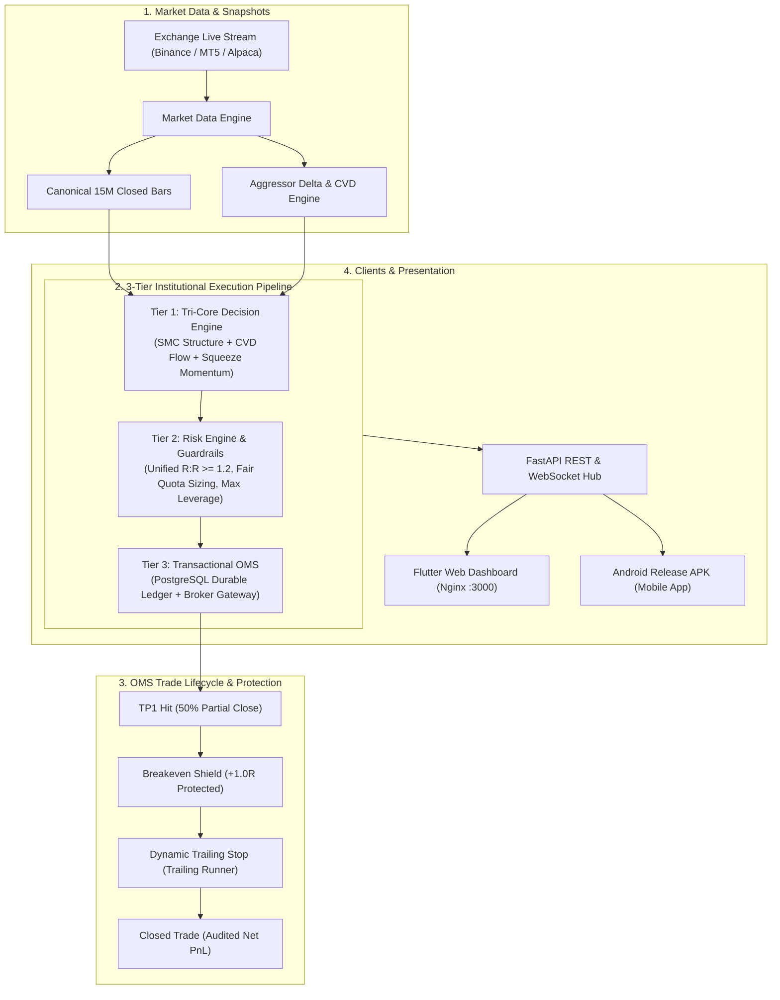
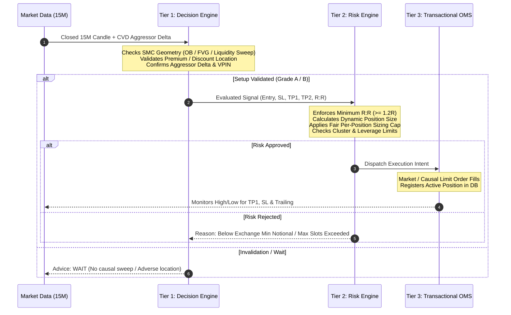

# AI Trade Advisor & Autonomous Execution Platform

> **Institutional-Grade Rule-Based & Advisory AI Trading System**  
> Operating on Deterministic Core Authorities, Canonical 15M Snapshots, Multi-bar Orderflow (SMC + CVD), 3-Tier Autonomous Execution Pipeline, and Real-Time Risk Guardrails.

---

## 🏛️ System Architecture

The platform is designed with strict **Authority Boundaries** separating Market Analysis, Decision Making, Risk Management, and Order Execution:



---

## ⚡ 3-Tier Execution Pipeline Overview



---

## 🌟 Key Features & Functional Modules

### 1. 🔍 Proactive SMC Scanner
* **Multi-Asset Watchlist**: Scans Crypto (Binance Futures), Forex & Gold (MT5), and US Equities (Alpaca).
* **Execution Timeframe (`15M`) with Multi-Timeframe Context (`1H / 4H`)**: Higher timeframes provide structural bias (Market Regime, Trend Persistence), while entry triggers bind strictly to the closed 15M candle to prevent intrabar repainting.
* **Institutional Location Guard**: Automatically detects Discount vs. Premium zones. Unconditionally blocks buying in Premium or shorting in Discount.
* **Orderflow & CVD Evidence**: Evaluates Cumulative Volume Delta (CVD) divergence, absorption, and VPIN toxicity before approving setups.

### 2. 🧠 Tri-Core Decision Engine (Tier 1)
* **Deterministic Setup Identification**:
  * **Displacement-Retest**: Confirms aggressive institutional momentum breaking structure (`BOS`/`CHoCH`), waiting for the first retest into Order Blocks (`+OB`/`-OB`) or Fair Value Gaps (`FVG`).
  * **Causal Liquidity Sweep**: Identifies stops swept at `Strong Low` or `Strong High` followed by instant CVD absorption.
* **Setup Grading**: Ranks setups (`Grade A`, `Grade B`, or `WATCH`). Only qualifying grades proceed to execution.

### 3. 🛡️ Risk Engine with Max Leverage & Fair Quota (Tier 2)
* **Unified Minimum R:R ($\ge 1.2\text{R}$)**: Synchronized across the entire execution stack to ensure mathematical expectancy.
* **Configurable `Max Leverage` (1x – 25x UI / up to 50x Backend)**:
  * Users can adjust portfolio-wide leverage directly from the Settings screen or API.
* **Fair Per-Position Sizing Quota Cap**:
  $$\text{Max Notional} = \text{Account Balance} \times \text{Max Leverage}$$
  $$\text{Per-Position Cap} = \frac{\text{Max Notional}}{\text{Max Open Positions}}$$
  * Prevents the first 1–2 positions from exhausting account purchasing power.
  * Guarantees every allowed concurrent slot can enter without violating exchange minimum notional filters.
* **Deep Pullback SL Padding**: Automatically enforces a minimum 0.35% safety margin on deep retracements from execution entry to prevent immediate whipsaws.
* **Cluster & Regime Risk Multipliers**: Automatically reduces risk allocation during ranging chop or high-correlation asset cluster exposure.

### 4. 📈 Transactional OMS & Smart Exits (Tier 3)
* **PostgreSQL Durable Execution Ledger**: Fully auditable record of fills, fees, slippage, and gross/net PnL.
* **Two-Stage Institutional Exit**:
  1. **Take Profit 1 (TP1)**: Hits first structural target (e.g., prior swing or 50% FVG), automatically closing **50%** of the position to secure initial profits.
  2. **Breakeven Shield Exit 🛡️**: As soon as TP1 fills, Stop Loss is instantaneously trailed to entry price plus transaction costs, guaranteeing a risk-free trade.
  3. **Dynamic Trailing Stop 📈**: The remaining 50% runner dynamically trails favorable price extremes (`protection_stage: trailing_dynamic`) to capture extended trends.

### 5. 📱 Cross-Platform UI (Flutter Web & Mobile)
* **High-Performance Canvas Chart**: Custom rendering of Order Blocks, FVGs, Equilibrium 50% line, Volume Moving Average 20, and live ticker badges.
* **Two-Way Synchronization**: Settings adjusted in the Flutter client immediately update the backend runtime store (`backend/config/runtime_settings.json`), ensuring seamless alignment between UI and execution bots.

---

## 📁 Repository Structure

```text
ai_trade_advisor/
├── backend/
│   ├── app/
│   │   ├── api/             # FastAPI endpoints (signals, chart, settings, paper trading)
│   │   ├── core/            # Configuration contracts, settings schemas, runtime state
│   │   ├── engines/         # Tri-Core SMC, Risk Engine, OMS, Backtest, and Indicators
│   │   ├── models/          # SQLAlchemy async PostgreSQL ORM models
│   │   └── services/        # EventTrigger, ExecutionRevalidator, CandidateLifecycle
│   ├── config/              # Strategy definitions and runtime_settings.json
│   ├── tests/               # Pytest suite covering Phase 1-5 remediations and risk limits
│   └── Dockerfile           # Backend containerization
├── mobile/                  # Flutter Client (Web PWA, Android Release APK, iOS)
│   ├── lib/
│   │   ├── core/            # API client, WebSocket manager, theme, and providers
│   │   └── features/        # Chart, Signals, Settings, Journal, and Apex AI screens
│   └── pubspec.yaml
├── web_dist/                # Compiled production web assets served by Nginx
├── releases/                # Built Android Release APKs
├── docker-compose.yml       # Production Docker orchestration
└── README.md
```

---

## 🛠️ Quick Start & How-To Guide

### 1. Prerequisites
- **Docker & Docker Compose** (Server / Local Deployment)
- **Python 3.12+** (Backend development)
- **Flutter 3.24+** (Mobile & Web client compilation)
- **Android SDK & platform-tools** (`adb` for device installation)

### 2. Configuration Setup
Create and configure your environment variables:
```bash
cp backend/.env.example backend/.env
# Update BINANCE_API_KEY, LOCAL_LLM_API_KEY, and database credentials
```

### 3. Launching with Docker Compose
```bash
docker-compose up -d --build
```
* **Web Dashboard**: `http://localhost:3000` (or server IP `:3000`)
* **Backend API & Swagger Docs**: `http://localhost:8000/docs`
* **Health Check**: `curl http://localhost:8000/health`

### 4. Adjusting Risk & Leverage Settings
Settings can be adjusted in two ways:
* **Via Mobile / Web UI**: Open **Settings** screen $\rightarrow$ navigate to **Risk Management** $\rightarrow$ adjust **Max Positions** and **Max Leverage (เพดานเลเวอเรจรวม)** sliders.
* **Via REST API**:
  ```bash
  curl -X POST http://localhost:8000/api/v1/settings/risk/config \
    -H "Content-Type: application/json" \
    -H "X-API-Key: <YOUR_API_KEY>" \
    -d '{
      "risk_per_trade": 2.0,
      "max_daily_loss": 3.0,
      "max_open_positions": 4,
      "max_leverage": 10.0,
      "auto_trade_enabled": true
    }'
  ```

### 5. Compiling & Deploying Flutter Clients

#### A. Build Flutter Web
```bash
cd mobile
flutter build web --release
# Copy web assets to distribution folder
cp -r build/web/* ../web_dist/
```

#### B. Build Android Release APK
```bash
cd mobile
flutter build apk --release
# Artifact generated at:
# mobile/build/app/outputs/flutter-apk/app-release.apk
```

#### C. Install APK on Connected Android Device / Emulator
```bash
adb install -r ../web_dist/app-release.apk
```

---

## 🛡️ Operational Safeguards

| Safeguard | Deterministic Rule |
| :--- | :--- |
| **Daily Loss Circuit Breaker** | Immediate trade suspension if cumulative daily loss reaches $\le -3.0\%$. |
| **Max Open Positions** | Hard cap on simultaneous active positions (default: 4 concurrent trades). |
| **Max Leverage Cap** | Enforces gross portfolio notional ceiling ($10\text{x}$ balance) with fair per-position quota division. |
| **Cluster Cooldown** | Prevents rapid consecutive losses by cooling down correlated pairs (e.g., L1 Crypto). |
| **Location Gate** | Unconditionally blocks buying at Premium ($\ge 50\%$ swing) or shorting at Discount ($\le 50\%$). |
| **Auto-Breakeven Shield** | Locks initial profit at $+1.0\text{R}$ / TP1 to guarantee zero downside on runners. |
| **Dynamic Trailing Stop** | Automatically secures trailing profits when prices extend into extreme favorable targets. |

---

## 📜 License & Compliance
This software is built for institutional-grade automated trading research, paper trade simulation, and rule-based advisory execution. Live execution with real capital must comply with exchange terms and local financial regulations.
