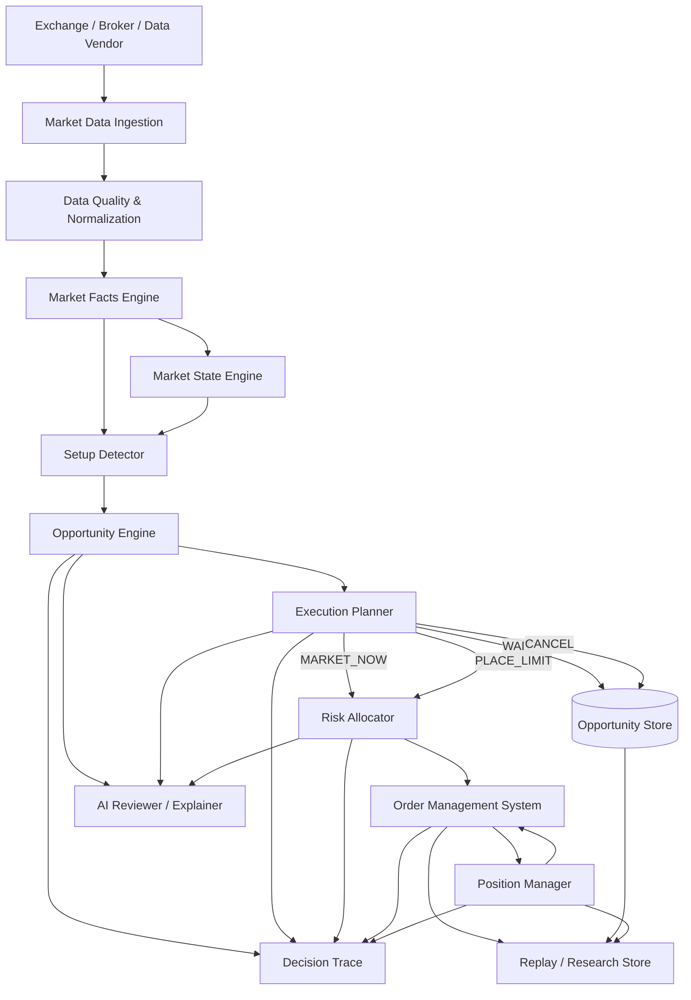
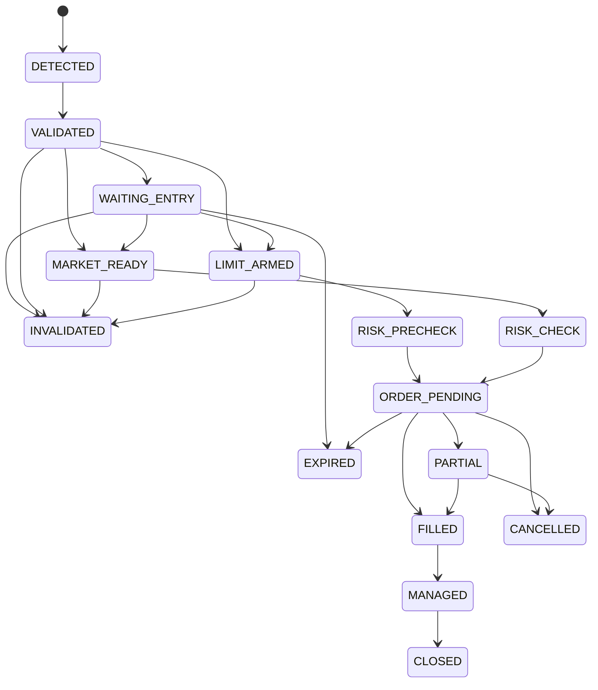
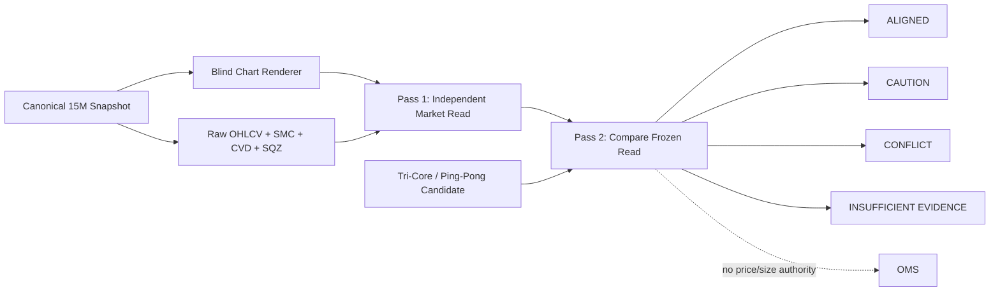

# Opportunity-Centric Autonomous Trading System
## Greenfield Blueprint — Architecture, System Flow, Concepts, Contracts, Prompts, and Build Plan

> **Purpose**
>
> This document is a complete greenfield blueprint for building a new automated trading system from zero.
> It is intentionally independent from any previous codebase.
>
> The core philosophy is:
>
> **Do not trade signals. Manage opportunities from discovery until fill, expiration, invalidation, or close.**
>
> AI is advisory only. Deterministic components own market facts, setup detection, execution, risk, orders, and position management.

---

# 0. Architectural Directive: "Evolve, not Revolve" (แผนกลยุทธ์การพัฒนาต่อยอดระบบ)

> **Core Strategic Decision: พัฒนาต่อยอด (Evolve, not Revolve) — ไม่รื้อเขียนใหม่แบบ Greenfield ทั้งหมด**
>
> Blueprint ฉบับนี้ทำหน้าที่เป็น **"เอกสารอ้างอิงคำศัพท์ ปรัชญา และขอบเขตอำนาจหน้าที่ (Vocabulary, Philosophy & Authority Reference)"** โดยจะไม่ทิ้งโครงสร้างพื้นฐานเดิมที่ผ่านการทดสอบและ Hardening มาอย่างเข้มข้นแล้ว แต่จะนำแก่นความคิดและจุดปรับปรุงที่ค้นพบมาพัฒนาต่อยอดแบบ Incremental Patch

---

## 1. ทำไมถึง "ไม่ควร Rewrite แบบ Greenfield ทั้งหมด"

จากการรีวิวเชิงลึก โค้ดปัจจุบันกว่า **80–85% มีรากฐานสถาปัตยกรรมที่สอดคล้องกับ Blueprint และผ่านการ Battle-tested มาแล้ว**:

| Blueprint Concept | โครงสร้างที่มีอยู่แล้วและผ่านการ Hardened ใน Codebase |
| :--- | :--- |
| **Deterministic Setup Authority** | `TriCoreSetupEngine` เป็นผู้มีอำนาจเด็ดขาดในการคัดกรอง Setup โดยห้าม AI หรือ Indicator แทรกแซงราคา |
| **Candidate/Opportunity Lifecycle** | `candidate_lifecycle.py` มี State Machine และระบบ Supersession (Event ใหม่คู่นั้นแทนที่ Candidate เดิม) ที่ละเอียดและปลอดภัย |
| **Fail-Closed Execution Boundary** | `execution_revalidator.py` ตรวจสอบทั้ง Spread, Slippage, Fee, Extension ATR ก่อนส่งออเดอร์ |
| **Immutable Decision Audit Trace** | `decision_trace.py` มีระบบบันทึก Audit trail แบบ Append-only พร้อม Hash-verification ตรวจจับ Tampering |
| **Independent Multimodal AI Reviewer** | `scanner_ai.py` ให้โมเดลอ่านกราฟ 15M + OHLCV/SMC/CVD แบบ blind ก่อนเห็น Candidate แล้วจึงเปรียบเทียบกับ Tri-Core รอบที่สอง โดยยังล็อคไม่ให้ AI ป้อนราคา/ขนาดไม้หรือแก้แผน |
| **Anti-Repaint SMC Facts** | `smc_engine.py` และ `indicators.py` มีการตรวจสอบ `confirmed_index` เพื่อป้องกัน Data Leakage และ Hindsight Bias |
| **Transactional Paper OMS** | `paper_oms.py` มีระบบกู้คืนสถานะจาก PostgreSQL รองรับ Partial Fills, Trailing Stop และ Breakeven อย่างถูกต้อง |

> [!WARNING]
> **ความเสี่ยงจากการ Rewrite ใหม่ทั้งหมด (17 Phases)**:
> การรื้อเขียนใหม่ทั้งหมดจะสูญเสียงาน Hardening และ Bug fixes นับสิบรอบ แลกกับความเสี่ยงเรื่อง Regression สูงและใช้เวลาล่าช้าหลายสัปดาห์ ในขณะที่ปัญหาจริงที่ระบบขาดมีเพียงไม่กี่จุด ซึ่งสามารถแก้ไขได้ทันทีด้วยแนวทาง **Evolve, not Revolve**

---

## 2. วิเคราะห์ 10 จุดบกพร่องใน Blueprint ที่ต้องปรับปรุง (Gap Analysis)

| # | จุดบกพร่องใน Blueprint | ผลกระทบจริงในระบบ | แผนและทางออกที่ถูกต้อง (Evolve Fix) |
|---|:---|:---|:---|
| **1** | **`EXECUTION_REJECTED` ใน Terminal state ขัดกับ Section 2.5** | Section 2.5 ห้าม Reject เพียงเพราะ R:R ชั่วขณะไม่ดี แต่ Section ท้ายยังมี `EXECUTION_REJECTED` ทำให้สับสนว่าเหลือไว้ทำอะไร | สงวน `EXECUTION_REJECTED` ไว้เฉพาะกรณี Invalid Geometry, Data เสียหาย หรือเงื่อนไขโครงสร้างผิดจริงเท่านั้น |
| **2** | **Mermaid Diagram (Sec 16) ไม่มี Path ถอยกลับไป `WAITING_ENTRY`** | ในตลาดจริงราคาแกว่งเข้า-ออกโซนบ่อยครั้ง หาก R:R แย่ลงในแท่งถัดไป Candidate จะไม่มีสถานะรองรับและหลุด Pipeline | เพิ่ม State `WAITING_ENTRY` / `LIMIT_ARMED` เพื่อให้ราคาสามารถแกว่งรอ Retest โดยไม่ถูกกำจัดทิ้ง |
| **3** | **State Diagram ตกหล่น `RISK_REJECTED`** | แผนภาพแสดงเฉพาะเส้นทางไป `ORDER_PENDING` ไม่มี Edge ไปยัง Risk Rejection | อัปเดต Diagram และ State Machine ให้มี Branch ของ `RISK_REJECTED` ที่ชัดเจน |
| **4** | **Position Sizing (Sec 25) ลืม Aggregate Portfolio Exposure** | สูตรคิดเฉพาะความเสี่ยงไม้เดียว ไม่รวมกับความเสี่ยงสะสมของพอร์ต เสี่ยง Over-leverage รวม | ปรับสูตรใน `risk_engine.py`: $\text{OPEN} + \text{PENDING} + \text{NEW} \le \text{Equity} \times \text{Max Leverage}$ |
| **5** | **Persistence Model (Sec 33) ขาด Table สำหรับ Circuit Breaker** | มี Backlog RISK-004 แต่ไม่มีตารางรองรับ ทำให้ Circuit Breaker อาจหายไปเมื่อ Restart | ผูก `PersistentRiskGuard` เข้ากับตาราง `paper_oms_risk_halts` ใน PostgreSQL อย่างถาวร |
| **6** | **AI `CONFLICT` คลุมเครือว่าจะ Block หรือแค่ Annotate** | หากตั้ง Default เป็น false เมื่อเกิด Fact ขัดแย้งรุนแรง (เช่น SMC สั่ง Long แต่ CVD เทขายหนัก) ระบบจะยังปล่อยเทรด | กำหนดให้ AI `CONFLICT` เป็น **Fail-Closed (Blocking)** เป็นค่า Default เพื่อความปลอดภัยสูงสุด (มี Toggle สำหรับ Manual override) |
| **7** | **ขอบเขต Setup Detector vs Market Facts เรื่อง Flow Confirmation** | ความกำกวมว่าใครเป็นผู้ตัดสินว่า Flow คอนเฟิร์มทิศทางของ Setup | มอบอำนาจให้ `TriCoreSetupEngine` เป็นผู้ประเมิน Fact เทียบกับ Direction ของ Setup โดยเฉพาะ |
| **8** | **ขาดรายละเอียด Anti-Repaint / Anti-Hindsight Bias** | เอกสารระบุเป็นหลักการกว้างๆ เสี่ยงที่การ Implement ใหม่จะเกิด Data Leakage | ยึดการทำงานของ `smc_engine.py` ปัจจุบันที่มีการเช็ค Index แท่งเทียนจริงก่อนยืนยันโซน |
| **9** | **กฎ Supersession / Replacement ยังไม่ละเอียด** | Blueprint ระบุเพียงบรรทัดเดียว ไม่ครอบคลุมกรณีทิศทางตรงข้ามหรือ Event ซ้อน | นำระบบ Supersession จาก `candidate_lifecycle.py` ที่ทำงานได้ดีอยู่แล้วมาเป็นมาตรฐาน |
| **10** | **Definition of Done ไม่ได้บังคับ Phase 13 (Counterfactual Study)** | ทีมอาจข้ามการประเมินว่า Market vs Limit คุ้มค่าจริงหรือไม่ | รวม Counterfactual Analysis ไว้ในการประเมิน Execution Policy ต่อเนื่อง |

---

## 3. แผนการนำข้อเสนอ "Evolve, not Revolve" มาต่อยอดทันที (Implementation Action Plan)

เรานำ 4 หัวใจหลักจาก Blueprint และผลรีวิวมาต่อยอดใน Codebase ปัจจุบัน:

### 1) ขยาย `CandidateState` ใน `candidate_lifecycle.py`
เพิ่มสถานะ Intermediate ที่ยืดหยุ่นก่อนถึง `EXECUTION_VALIDATED`:
```text
EXECUTION_VALIDATING → {EXECUTION_VALIDATED, WAITING_ENTRY, LIMIT_ARMED, EXECUTION_REJECTED, INVALIDATED, EXPIRED}
WAITING_ENTRY        → {MARKET_READY, LIMIT_ARMED, INVALIDATED, EXPIRED}
LIMIT_ARMED          → {EXECUTION_VALIDATED (fill), WAITING_ENTRY (de-arm), INVALIDATED, EXPIRED}
```
* **`WAITING_ENTRY`**: Setup ผ่านเกณฑ์ แต่ราคาปัจจุบันยังยืดตัว รอ Retest เข้าโซนในแท่งถัดไป
* **`LIMIT_ARMED`**: ตั้ง Limit Order ดักไว้ที่โซนเรียบร้อย ไม่ถูกมองว่า Rejected

### 2) ปรับ `execution_revalidator.py` ให้คืนค่า `ExecutionIntent` (4 รูปแบบ)
แทนที่ Boolean pass/fail แบบเดิมด้วย Intent ที่ชัดเจน:
* **`MARKET_NOW`**: ราคาปัจจุบันอยู่ในโซนและได้ R:R $\ge 2.0$ ทันที พร้อมยิง Market Order
* **`PLACE_LIMIT`**: ราคาเหมาะสมกับการวาง Limit Order ดักในโซน (`LIMIT_ARMED`)
* **`WAIT`**: ราคายืดเกินไป รอการทดสอบโซนใหม่อีกครั้ง (`WAITING_ENTRY`)
* **`CANCEL` / `REJECT`**: ยกเลิกเฉพาะเมื่อ Structural Geometry เสียหาย หรือข้อมูลตลาดผิดปกติจริงเท่านั้น

### 3) เสริม Aggregate Portfolio Exposure Cap ใน `risk_engine.py`
คำนวณ Leverage รวมของทั้งพอร์ต:
$$\text{Notional}_{\text{Open}} + \text{Notional}_{\text{Pending}} + \text{Notional}_{\text{New}} \le \text{Equity} \times \text{Max Leverage}$$
และบันทึก Circuit Breaker Halts ลงฐานข้อมูล PostgreSQL ผ่าน `PersistentRiskGuard` ทุกครั้ง

### 4) ยึดหลักความปลอดภัย Fail-Closed สำหรับ AI Review
* หาก AI Review ให้ผลลัพธ์เป็น **`CONFLICT`** ให้ถือเป็น Gate บล็อกคำสั่งอัตโนมัติเป็น Default
* ผู้ใช้สามารถเลือกโหมด Advisory Soft Gate ได้ใน Settings หากต้องการเทรดตาม TriCore เพียงอย่างเดียว

---

# 1. Vision

Build a trading platform that is:

- deterministic at its core;
- opportunity-centric, not indicator-score-centric;
- explicit about data quality and uncertainty;
- execution-aware before order creation;
- persistent across scans and candles;
- auditable end-to-end;
- safe under stale data, provider outages, and partial failures;
- replayable using historical data;
- capable of evaluating market vs limit execution separately;
- modular enough to add exchanges, symbols, and strategy families without changing core authority boundaries.

The system must answer six questions for every possible trade:

1. **WHERE is the opportunity?**
2. **WHY should price move?**
3. **WHEN should we enter?**
4. **WHEN are we wrong?**
5. **HOW MUCH can we lose?**
6. **HOW do we manage the position after fill?**

---

# 2. Foundational Principles

## 2.1 Deterministic authority

The following components are deterministic authorities:

- Market Facts Engine
- Opportunity Engine
- Execution Planner
- Risk Allocator
- OMS
- Position Manager

AI is not allowed to:

- choose trade direction;
- create a new opportunity;
- change entry;
- change stop-loss;
- change take-profit;
- change position size;
- bypass risk rules;
- submit or cancel orders;
- modify portfolio limits.

## 2.2 AI is advisory

AI may:

- summarize current market context;
- detect contradictions in deterministic facts;
- review an existing opportunity;
- explain why the system is waiting, entering, cancelling, or rejecting;
- perform post-trade analysis;
- help humans inspect logs and decisions.

Default behavior:

```text
AI unavailable
→ deterministic trading engine continues according to deterministic policy
```

Optional operator policy:

```text
require_ai_review = true
→ deterministic candidate pauses until AI review is available
```

But this is not the recommended default.

## 2.3 Opportunity, not signal

The system never creates a generic “BUY SIGNAL”.

It creates a persistent `Opportunity`.

Example:

```text
Opportunity detected
→ valid setup
→ current market entry is poor
→ wait for causal limit
→ revalidate every closed candle
→ fill / expire / invalidate
```

## 2.4 Setup validity and entry timing are separate

A setup can remain valid while the current market price is not executable.

Therefore:

```text
VALID SETUP != ENTER NOW
```

The execution engine may decide:

```text
MARKET_NOW
PLACE_LIMIT
WAIT
CANCEL
```

## 2.5 “Rejected” is terminal

Use `REJECTED` only when the opportunity should not continue.

Do not use `REJECTED` merely because current market R:R is poor.

Poor market execution with a valid causal zone should normally become:

```text
WAITING_ENTRY
or
LIMIT_ARMED
```

---

# 3. High-Level Architecture



---

# 4. Authority Model

```text
Market Data Layer
    owns raw market observations

Data Quality Layer
    owns freshness/source/quality state

Market Facts Engine
    owns deterministic market facts

Market State Engine
    owns environment classification

Setup Detector
    owns setup detection

Opportunity Engine
    owns opportunity identity + lifecycle

Execution Planner
    owns Market / Limit / Wait / Cancel decision

Risk Allocator
    owns size + portfolio risk acceptance

OMS
    owns order lifecycle

Position Manager
    owns post-fill trade management

AI
    owns explanation/review only
```

No component may silently assume another component’s authority.

---

# 5. Canonical System Flow

```text
1. Receive market data
2. Normalize timestamps/prices/volume
3. Evaluate data quality
4. Build closed-candle canonical frame
5. Calculate market facts
6. Classify market state
7. Detect deterministic setup
8. Create/update Opportunity
9. Run optional AI review
10. Run Execution Planner
11. MARKET / LIMIT / WAIT / CANCEL
12. Risk pre-check
13. Risk final assessment before submission
14. Submit order to OMS
15. Monitor pending order
16. Revalidate opportunity
17. Fill / Partial / Cancel / Expire
18. Position Manager takes ownership
19. Exit position
20. Store full replay record
21. Analyze performance by setup family and execution path
```

---

# 6. Market Data Layer

## 6.1 Required inputs

Core:

- OHLCV
- Bid
- Ask
- Trade prints
- Aggressor side if available
- Tick size
- Lot size
- Minimum quantity
- Minimum notional
- Session calendar

Optional:

- Order book depth
- Open interest
- Funding
- Liquidations
- Market-wide breadth
- FX conversion rates
- Index/reference price

## 6.2 Every market datum has quality metadata

Example:

```json
{
  "value": 123.45,
  "source": "binance",
  "received_at": "2026-09-23T05:00:00.210Z",
  "exchange_timestamp": "2026-09-23T05:00:00.100Z",
  "age_ms": 110,
  "quality": "exchange_native"
}
```

## 6.3 Quality categories

```text
EXCHANGE_NATIVE
BROKER_NATIVE
DERIVED
INFERRED
SYNTHETIC
STALE
MISSING
UNKNOWN
```

## 6.4 Required invariants

Reject execution when:

- quote timestamp missing;
- quote too stale;
- quote materially in the future;
- ask < bid;
- price <= 0;
- spread outside configured limits;
- exchange session unavailable;
- instrument metadata unavailable.

---

# 7. Canonical Analysis Timeframe

Start with **one execution timeframe**.

Recommended:

```text
15m closed candles
```

Reasons:

- easier replay;
- avoids forming-candle leakage;
- stable enough for structural concepts;
- compatible with intraday execution;
- lower microstructure noise than very small timeframes.

Higher timeframes can be context only.

Example:

```text
15m = execution authority
1H / 4H = context only
3m / 5m = optional entry refinement only
```

No higher/lower timeframe may upgrade a failed canonical setup.

---

# 8. Market Facts Engine

The Market Facts Engine calculates facts, not trade votes.

Recommended facts:

## 8.1 Structure

- swing highs/lows;
- BOS;
- CHoCH;
- displacement;
- impulsive vs corrective movement;
- reclaim;
- breakout failure.

## 8.2 Liquidity

- equal highs;
- equal lows;
- prior session highs/lows;
- swing liquidity;
- liquidity sweeps;
- stop-run characteristics.

## 8.3 Zones

- Order Blocks
- Fair Value Gaps
- Breakers
- Range premium/discount
- Supply/demand boundaries

## 8.4 Flow

Priority:

```text
true aggressor delta
→ true CVD
→ inferred delta
→ candle-volume proxy
```

Facts should carry quality:

```json
{
  "cvd_direction": "bullish",
  "source": "true_aggressor",
  "quality": "high"
}
```

## 8.5 Volatility

- ATR
- realized volatility
- ATR percentile
- spread percentile
- price-path efficiency
- compression/expansion measures

---

# 9. Market State Engine

Market State describes environment, not trade direction.

Recommended states:

```text
TREND
RANGE
COMPRESSION
EXPANSION
HIGH_VOLATILITY
ILLIQUID
UNKNOWN
```

Recommended metrics:

```json
{
  "state": "RANGE",
  "confidence": 0.78,
  "trend_strength": 0.23,
  "range_efficiency": 0.71,
  "atr_percentile": 44,
  "liquidity_quality": 0.88
}
```

## 9.1 State does not choose LONG/SHORT

Bad:

```text
bullish regime = BUY
```

Good:

```text
range state enables range-fade setups
trend state enables continuation setups
```

---

# 10. Setup Families

Keep strategy families intentionally small.

Recommended initial families:

```text
REVERSAL
CONTINUATION
RANGE_FADE
BREAKOUT_RETEST
```

Do not begin with dozens of setup types.

---

# 11. Setup Family: REVERSAL

Concept:

```text
liquidity taken
→ reclaim
→ displacement opposite prior move
→ flow confirms or at least does not strongly oppose
```

Long example:

```text
sell-side liquidity sweep
→ bullish reclaim
→ bullish displacement
→ bullish/non-opposing flow
→ entry near causal demand
```

Short is mirrored.

---

# 12. Setup Family: CONTINUATION

Concept:

```text
impulse
→ confirmed structure break
→ controlled retracement
→ causal OB/FVG/breaker retest
→ flow remains aligned/non-opposing
```

Important:

Trend context may increase suitability, but the setup must still be independently causal.

---

# 13. Setup Family: RANGE_FADE

Concept:

```text
validated range
→ price tests outer boundary
→ no strong breakout participation
→ fade toward opposing major boundary
```

Long:

```text
discount / demand boundary
→ target major supply / premium
```

Short mirrored.

Avoid treating:

```text
not trending = ranging
```

Range must be explicit.

---

# 14. Setup Family: BREAKOUT_RETEST

Concept:

```text
compression/range
→ genuine displacement breakout
→ structure acceptance
→ retest
→ continuation
```

Avoid breakout chasing.

---

# 15. Opportunity Object

This is the system’s central domain entity.

```python
Opportunity(
    opportunity_id: str,
    lineage_id: str,

    symbol: str,
    market_type: str,
    exchange: str,
    timeframe: str,

    direction: Literal["long", "short"],
    family: Literal[
        "reversal",
        "continuation",
        "range_fade",
        "breakout_retest"
    ],

    thesis: dict,
    evidence: list[str],

    entry_zone: dict,
    structural_entry: float,
    stop_loss: float,
    targets: list[dict],

    invalidation: dict,

    state: str,

    created_at: datetime,
    valid_until: datetime,
    ttl_bars: int,

    data_quality: dict,
    market_state: dict,

    version: int
)
```

---

# 16. Opportunity Lifecycle



---

# 17. Execution Planner

The Execution Planner owns timing.

Input:

```text
Opportunity
Current bid/ask
ATR
Spread
Fees
Slippage
Causal entry zone
Current volatility
Time since opportunity creation
```

Output:

```text
MARKET_NOW
PLACE_LIMIT
WAIT
CANCEL
```

---

# 18. Execution Decision Logic

## 18.1 MARKET_NOW

Requirements:

```text
opportunity valid
AND quoted RR >= minimum
AND adverse extension <= threshold
AND spread acceptable
AND quote fresh
AND geometry valid
```

## 18.2 PLACE_LIMIT

Use when:

```text
opportunity valid
AND current market execution is poor
AND active causal entry zone still exists
AND structural/limit RR >= minimum
```

## 18.3 WAIT

Use when:

```text
opportunity valid
BUT price is neither market-executable
NOR sufficiently close to arm limit
```

## 18.4 CANCEL

Use when:

```text
thesis invalidated
zone mitigated
TTL expired
structure changed
market closed unexpectedly
data quality unacceptable
```

---

# 19. R:R Model

Track three R:R values.

## 19.1 Structural R:R

```text
ideal structural entry
vs
structural invalidation
vs
structural target
```

## 19.2 Quoted R:R

Uses:

- current bid/ask;
- spread;
- fees;
- modeled slippage.

## 19.3 Expected R:R

Optional later phase:

```text
expected fill probability
expected cost
expected target probability
```

Do not start with expected R:R until sufficient data exists.

---

# 20. Example Execution Logic

```python
if not opportunity.valid:
    return CANCEL

if quote.stale:
    return WAIT

market_rr = calculate_executable_rr(
    entry=quote.executable_price,
    stop=opportunity.stop_loss,
    target=opportunity.primary_target,
)

if (
    market_rr >= policy.minimum_rr
    and adverse_extension_atr <= policy.market_max_extension_atr
):
    return MARKET_NOW

if opportunity.causal_zone.active:
    limit_rr = calculate_executable_rr(
        entry=opportunity.structural_entry,
        stop=opportunity.stop_loss,
        target=opportunity.primary_target,
    )

    if limit_rr >= policy.minimum_rr:
        return PLACE_LIMIT

return WAIT
```

---

# 21. Stop-Loss Design

Never define stop loss primarily as a fixed percentage.

Use:

```text
structural invalidation
+ volatility buffer
+ market noise buffer
+ instrument tick constraints
```

Example:

```text
bullish OB bottom
- 0.15 ATR
- spread safety margin
```

Also apply minimum stop-distance policy:

```text
if stop_distance < minimum_noise_distance:
    reject / widen only if structural policy permits
```

Never widen a stop arbitrarily just to pass risk rules.

---

# 22. Target Design

Targets should be market-structure/liquidity-driven.

Priority examples:

- opposing range boundary;
- untouched opposing order block;
- opposing FVG;
- equal highs/lows;
- prior session extreme;
- major swing liquidity.

After choosing a meaningful target:

```text
check RR
```

Do not choose target solely to manufacture a desired RR.

---

# 23. Risk Allocator

Risk authority must be portfolio-aware.

Risk layers:

```text
Per Trade
Per Symbol
Per Strategy Family
Per Asset Cluster
Portfolio Gross Exposure
Daily Loss
Drawdown
```

Suggested initial conservative defaults for paper trading:

```yaml
risk:
  base_risk_per_trade_pct: 0.50
  max_risk_per_trade_pct: 1.00
  max_symbol_open_risk_pct: 1.50
  max_strategy_family_risk_pct: 2.00
  max_cluster_risk_pct: 3.00
  max_portfolio_open_risk_pct: 5.00
  max_daily_loss_pct: 3.00
```

These are initial engineering defaults, not claims of optimal profitability.

---

# 24. Risk Pre-Check vs Final Risk Check

Pending limits require two stages.

## Pre-check

When arming a limit:

```text
Would this opportunity currently fit risk constraints?
```

Do not permanently reserve full capital yet unless required.

## Final risk check

Immediately before order submission/fill:

```text
re-read account equity
re-read open positions
re-read cluster exposure
re-read circuit breaker
recalculate quantity
```

---

# 25. Position Sizing

Basic:

```text
risk_amount = equity * allowed_risk_pct
effective_stop_distance = abs(entry - stop) + modeled_costs
quantity = risk_amount / effective_stop_distance
```

Then normalize to:

- lot step;
- minimum quantity;
- minimum notional;
- maximum notional.

---

# 26. OMS

OMS owns orders after submission.

Required states:

```text
CREATED
PENDING
ACCEPTED
PARTIAL
FILLED
CANCEL_PENDING
CANCELLED
REPLACED
REJECTED
CLOSED
```

---

# 27. Pending Limit Lifecycle

Pending limit orders must be revalidated.

Every canonical closed candle:

```text
zone active?
thesis valid?
TTL remaining?
risk halt active?
newer opportunity superseded it?
```

Cancellation reasons:

```text
ZONE_INVALIDATED
STRUCTURE_INVALIDATED
TTL_EXPIRED
RISK_HALT
REPLACED_BY_NEW_OPPORTUNITY
SESSION_CLOSED
DATA_DEGRADED
MANUAL_CANCEL
```

---

# 28. Position Manager

After fill, Position Manager owns the trade.

Responsibilities:

- initial stop;
- break-even;
- trailing;
- partial exits;
- time stop;
- structural invalidation exit;
- terminal close.

Strategy-family-aware management is allowed.

Example:

```text
RANGE_FADE
→ stronger target orientation
→ fewer runners

CONTINUATION
→ partial + runner
→ structural trailing

REVERSAL
→ protect quickly after confirmed displacement
```

---

# 29. AI Architecture



หลักสำคัญของกระบวนการสองรอบ:

1. **Blind market read:** รอบแรก AI เห็นกราฟที่ render จาก execution snapshot เดียวกัน พร้อมข้อมูล OHLCV, SMC zones/structure, CVD และ SQZ แต่ไม่เห็น Grade, Direction ของ Candidate, Entry, SL, TP หรือผลสรุปของ Tri-Core จึงลด anchoring/confirmation bias
2. **Frozen comparison:** รอบที่สอง AI ได้รับผลอ่านตลาดรอบแรกที่ถูก freeze แล้ว และจึงเห็น Candidate ของ Tri-Core/Ping-Pong เพื่อเปรียบเทียบความสอดคล้อง
3. `ALIGNED` map เป็น reviewer `COHERENT`; `CAUTION`, `CONFLICT`, `INSUFFICIENT_EVIDENCE` และ `UNAVAILABLE` ล้วน fail-closed เป็น `WAIT`
4. ตัวตรวจ deterministic หลัง AI จะไม่ยอมให้ผล `ALIGNED` กลบ opposing CVD divergence, opposing flow, adverse location, crowded positioning หรือ single-bar delta ที่ยังไม่มี causal confirmation
5. AI ไม่มีสิทธิ์เปลี่ยน Direction, Entry, SL, TP, Risk หรือ Size และไม่สามารถสร้าง Candidate ใหม่
6. ภาพต้อง render จาก `snapshot_id` เดียวกับ structured payload และห้ามใช้ภาพหน้าจอจาก client ซึ่งอาจ stale

สถานะที่แสดงใน Decision Pipeline ระหว่างการประมวลผล:

```text
AI QUEUED → BLIND READING → COMPARING WITH TRICORE
          → ALIGNED / CAUTION / CONFLICT / INSUFFICIENT EVIDENCE / UNAVAILABLE
```

ทุกสถานะผูกกับ `snapshot_id` และ `event_id` เดียวกัน หาก snapshot ถูกแทนที่หรือหมดอายุ ผลลัพธ์จะถูก discard และห้ามนำไปอนุมัติคำสั่ง

โมเดลที่ใช้ใน production ปัจจุบันคือ `gemma4:31b-cloud` ผ่าน Ollama native API เนื่องจากรองรับภาพ ขณะที่โมเดล text-only จะใช้ structured reviewer เดิมและไม่ถูกอ้างว่าได้ตรวจภาพ

---

# 30. AI Review Contract

Pass 1 input (candidate ถูกซ่อน):

```json
{
  "snapshot_id": "...",
  "timeframe": "15m",
  "candles": [],
  "active_zones": [],
  "structure": {},
  "cvd": {},
  "squeeze": {},
  "chart_image": "snapshot-bound PNG"
}
```

Pass 1 output:

```json
{
  "market_state": "RANGE",
  "bias": "NEUTRAL",
  "location": "EQUILIBRIUM",
  "flow_state": "MIXED",
  "market_thesis": "...",
  "compatible_setups": [],
  "missing_evidence": [],
  "risk_flags": [],
  "evidence": []
}
```

Pass 2 input:

```json
{
  "snapshot_id": "...",
  "independent_market_read": {},
  "deterministic_setup": {},
  "tri_core_plan": {},
  "execution_quote": {}
}
```

Output:

```json
{
  "comparison_verdict": "ALIGNED",
  "reason": "Deterministic facts are internally consistent.",
  "conflicts": [],
  "evidence": [
    "range boundary active",
    "flow not opposing"
  ]
}
```

Allowed comparison verdicts:

```text
ALIGNED
CONFLICT
INSUFFICIENT_EVIDENCE
UNAVAILABLE
```

AI may not return:

```text
entry
stop_loss
take_profit
position_size
order_type
```

If present, ignore and log authority violation.

---

# 31. AI System Prompt

Use this as a baseline:

```text
You are an advisory reviewer for a deterministic trading system.

You are NOT the trading authority.

The deterministic Opportunity Engine owns:
- direction
- setup family
- structural entry
- stop-loss
- targets
- invalidation

The Execution Planner owns:
- MARKET_NOW
- PLACE_LIMIT
- WAIT
- CANCEL

The Risk Allocator owns:
- position sizing
- portfolio acceptance

The OMS owns:
- order creation
- cancellation
- replacement

Your job is ONLY to:
1. inspect the supplied deterministic facts;
2. identify contradictions or missing context;
3. classify the opportunity as COHERENT, CONFLICT, or UNAVAILABLE;
4. explain the reason concisely;
5. cite evidence from the supplied context.

Never invent prices.
Never change direction.
Never change stop-loss.
Never change targets.
Never recommend position size.
Never override risk.
Never issue an order instruction.

Return strict JSON only:

{
  "verdict": "COHERENT | CONFLICT | UNAVAILABLE",
  "reason": "string",
  "conflicts": ["string"],
  "evidence": ["string"]
}

Maximum conflicts: 6
Maximum evidence items: 8
```

---

# 32. Decision Trace

Every meaningful action must be recorded.

Example stages:

```text
MARKET_DATA
DATA_QUALITY
FACTS
MARKET_STATE
SETUP_DETECTED
OPPORTUNITY_CREATED
AI_REVIEW
EXECUTION_PLAN
RISK_PRECHECK
RISK_FINAL
OMS_SUBMIT
OMS_RESULT
POSITION_UPDATE
EXIT
```

Trace record:

```json
{
  "trace_id": "trace-...",
  "opportunity_id": "opp-...",
  "stage": "EXECUTION_PLAN",
  "timestamp": "...",
  "facts": {
    "decision": "PLACE_LIMIT",
    "market_rr": 0.92,
    "limit_rr": 2.17,
    "minimum_rr": 1.5
  }
}
```

---

# 33. Persistence Model

Recommended tables:

## market_snapshots

- id
- symbol
- exchange
- timeframe
- candle_close_time
- payload_hash
- created_at

## opportunities

- opportunity_id
- lineage_id
- symbol
- direction
- family
- state
- structural_entry
- stop_loss
- primary_target
- causal_zone_id
- created_at
- valid_until
- ttl_bars
- version

## opportunity_events

Append-only event log.

## execution_intents

- opportunity_id
- intent
- market_rr
- limit_rr
- executable_entry
- reason
- created_at

## orders

OMS records.

## positions

Filled positions.

## decision_trace

Audit trail.

## ai_reviews

Advisory reviews.

## replay_results

Historical simulation outputs.

---

# 34. Event-Driven Design

Recommended domain events:

```text
MarketSnapshotClosed
MarketFactsCalculated
MarketStateUpdated
SetupDetected
OpportunityCreated
OpportunityUpdated
OpportunityInvalidated
ExecutionIntentCreated
LimitArmed
MarketEntryReady
RiskApproved
RiskRejected
OrderSubmitted
OrderFilled
OrderCancelled
PositionUpdated
PositionClosed
```

Use an internal event bus first.

Do not start with Kafka unless scale requires it.

Simple choices:

- Python async event dispatcher
- Redis Streams
- PostgreSQL outbox

Recommended first production-capable option:

```text
PostgreSQL + transactional outbox
```

---

# 35. Suggested Technology Stack

## Backend

```text
Python 3.12+
FastAPI
Pydantic v2
SQLAlchemy 2
PostgreSQL 16+
Redis
asyncio
httpx
pandas / polars
```

## Market adapters

```text
ccxt where appropriate
native exchange SDKs for critical execution
websocket adapters
```

## Frontend

```text
Flutter
or
React/Next.js
```

If mobile + web from one codebase is a priority:

```text
Flutter
```

## Observability

```text
Prometheus
Grafana
structured JSON logs
OpenTelemetry later
```

## Deployment

```text
Docker Compose initially
Kubernetes later
```

Do not begin with Kubernetes unless deployment complexity requires it.

---

# 36. Recommended Project Structure

```text
trading-system/
├── backend/
│   ├── app/
│   │   ├── api/
│   │   ├── core/
│   │   │   ├── config.py
│   │   │   ├── clock.py
│   │   │   ├── ids.py
│   │   │   └── events.py
│   │   ├── domain/
│   │   │   ├── opportunity.py
│   │   │   ├── execution.py
│   │   │   ├── risk.py
│   │   │   ├── order.py
│   │   │   └── position.py
│   │   ├── market_data/
│   │   ├── facts/
│   │   ├── market_state/
│   │   ├── setups/
│   │   │   ├── reversal.py
│   │   │   ├── continuation.py
│   │   │   ├── range_fade.py
│   │   │   └── breakout_retest.py
│   │   ├── opportunity/
│   │   ├── execution/
│   │   ├── risk/
│   │   ├── oms/
│   │   ├── positions/
│   │   ├── ai/
│   │   ├── replay/
│   │   ├── observability/
│   │   └── persistence/
│   ├── tests/
│   ├── migrations/
│   └── config/
│
├── mobile/
│   └── ...
│
├── infra/
│   ├── docker/
│   └── monitoring/
│
├── docs/
│   ├── architecture.md
│   ├── authority.md
│   └── replay.md
│
├── docker-compose.yml
└── README.md
```

---

# 37. Configuration Model

Example:

```yaml
system:
  canonical_timeframe: 15m
  closed_candle_only: true

execution:
  minimum_executable_rr: 1.5
  max_quote_age_seconds: 10
  max_future_quote_skew_seconds: 1
  max_spread_pct: 0.01

  market_max_extension_atr: 0.25
  no_chase_max_extension_atr: 0.60

opportunity:
  default_ttl_bars: 2

risk:
  base_risk_per_trade_pct: 0.50
  max_risk_per_trade_pct: 1.00
  max_daily_loss_pct: 3.00
  max_portfolio_open_risk_pct: 5.00

ai:
  enabled: true
  require_for_execution: false
  provider: local
  timeout_seconds: 20

data_quality:
  require_fresh_quote: true
  reject_unknown_instrument_rules: true
```

---

# 38. Safety Invariants

These must be hard rules.

## Market-data safety

```text
No stale quote execution
No missing timestamp execution
No invalid bid/ask execution
No future timestamp beyond tolerance
```

## Opportunity safety

```text
No order without opportunity_id
No direction mutation
No stale/replaced opportunity execution
No expired opportunity execution
```

## Execution safety

```text
No market order below minimum executable R:R
No chase beyond policy
No limit without active causal zone
No execution outside valid geometry
```

## Risk safety

```text
No order without final risk approval
No order during portfolio halt
No order beyond max exposure
No negative/zero quantity
```

## OMS safety

```text
Idempotency required
Duplicate submission blocked
Order state transitions validated
```

## AI safety

```text
AI cannot modify trade plan
AI cannot create order
AI unavailable does not silently rewrite deterministic state
```

---

# 39. Failure Modes

Explicitly design for:

```text
Exchange API unavailable
WebSocket disconnected
Quote stale
Database unavailable
Redis unavailable
AI provider unavailable
Order timeout
Partial fill
Duplicate event
Clock skew
Out-of-order market data
Session closed
Instrument rules changed
Risk guard halt
```

Every failure must produce:

```text
reason_code
human-readable reason
structured log
trace event
```

---

# 40. UI Model

Main opportunity card should show:

```text
Symbol
Market State
Opportunity Family
Direction
Opportunity State

Setup:
VALID / INVALID

AI:
COHERENT / CONFLICT / NOT REQUESTED / UNAVAILABLE

Execution:
MARKET READY
WAITING ENTRY
LIMIT ARMED
CANCELLED

Risk:
PRE-CHECK OK
APPROVED
REJECTED

Order:
NOT CREATED
PENDING
PARTIAL
FILLED
CANCELLED
```

Do not use red error styling for normal waiting states.

---

# 41. Example UI Flow

```text
SOL/USDT
RANGE

Opportunity
SHORT • RANGE_FADE

Setup
VALID

AI
COHERENT

Execution
LIMIT ARMED
Ideal Entry: 119.50
Current Market: 119.98
Market RR: 0.92R
Limit RR: 2.17R
Minimum: 1.50R

Risk
PRE-CHECK OK

OMS
WAITING FOR FILL

Expires
2 closed 15m bars
```

This communicates intent much better than:

```text
Execution REJECTED
Risk NOT RUN
OMS NOT SUBMITTED
```

---

# 42. Replay Architecture

Replay must reproduce:

```text
closed candle facts
setup detection
opportunity creation
execution decisions
pending limit evolution
fill simulation
risk calculation
position management
```

No future data leakage.

---

# 43. Replay Metrics

Overall:

- trade count
- win rate
- expectancy R
- profit factor
- max drawdown
- Sharpe/Sortino later
- average holding period

Execution:

- market entries
- limit entries
- limit fill rate
- missed-limit rate
- expired limits
- invalidated-before-fill
- slippage
- spread cost
- MAE
- MFE

Break down by:

```text
strategy family
market state
symbol class
session
volatility bucket
data quality
execution type
```

---

# 44. Counterfactual Replay

This is highly valuable.

For each opportunity:

```text
What happened if:
A) market entered immediately?
B) waited for structural limit?
C) skipped?
```

Store:

```text
market_result_r
limit_result_r
limit_filled
limit_wait_bars
invalidated_before_fill
```

This is how execution policy should eventually be calibrated.

---

# 45. Testing Strategy

## Unit tests

Every domain rule.

Examples:

```text
range fade cannot occur outside explicit range
market RR below floor cannot market-enter
low market RR + valid causal zone can arm limit
expired opportunity cannot execute
AI cannot change direction
```

## Contract tests

For:

- Opportunity schema
- ExecutionIntent schema
- OMS payload
- AI review schema

## Integration tests

```text
Facts → Setup → Opportunity → Execution → Risk → OMS
```

## Replay tests

Golden deterministic datasets.

## Safety regression

Always test:

```text
stale quote
future quote
duplicate order
expired setup
invalid geometry
oversized position
risk halt
provider outage
```

---

# 46. Required Acceptance Criteria

System is not considered ready until:

```text
All core domain tests pass
No non-deterministic setup authority
No execution without fresh quote
No order without risk approval
No AI authority leakage
Persistent opportunity lifecycle works
Pending limits revalidate
Replay is deterministic
Full decision trace available
```

---

# 47. Build Plan

## Phase 0 — Domain Contracts

Build only:

- Opportunity
- ExecutionIntent
- RiskAssessment
- Order
- Position
- reason codes
- event contracts

No exchange API yet.

Acceptance:

```text
domain objects immutable where appropriate
state transitions tested
```

---

## Phase 1 — Market Data + Data Quality

Build:

- exchange adapter
- closed candle builder
- bid/ask quote
- clock/freshness checks
- instrument metadata

Acceptance:

```text
reliable canonical 15m snapshots
```

---

## Phase 2 — Market Facts

Build:

- structure
- liquidity
- zones
- CVD/delta
- volatility

Acceptance:

```text
no future leakage
facts reproducible in replay
```

---

## Phase 3 — Market State

Build deterministic state classifier.

No trade decisions.

---

## Phase 4 — Setup Detector

Implement only:

```text
REVERSAL
CONTINUATION
RANGE_FADE
BREAKOUT_RETEST
```

Acceptance:

```text
setup family tests
direction tests
causal evidence tests
```

---

## Phase 5 — Opportunity Engine

Implement persistence + lifecycle.

Acceptance:

```text
same opportunity survives multiple scans
duplicate opportunity not created
TTL works
invalidation works
```

---

## Phase 6 — Execution Planner

Implement:

```text
MARKET_NOW
PLACE_LIMIT
WAIT
CANCEL
```

Acceptance:

```text
market vs limit behavior deterministic
RR floor preserved
no chase preserved
```

---

## Phase 7 — Risk Allocator

Implement portfolio-aware risk.

Start paper-only.

---

## Phase 8 — OMS

Implement:

```text
pending
partial
filled
cancel
replace
```

With idempotency.

---

## Phase 9 — Position Manager

Implement stop/target/management.

---

## Phase 10 — AI Reviewer

Only after deterministic pipeline is stable.

AI is advisory.

---

## Phase 11 — UI

Build opportunity-centric UI.

---

## Phase 12 — Replay

Historical deterministic engine.

---

## Phase 13 — Counterfactual Execution Study

Market vs Limit vs Skip.

---

## Phase 14 — OOS Walk-Forward

No tuning on final test set.

---

## Phase 15 — Paper Trading

Long-running paper validation.

---

## Phase 16 — Live Shadow Mode

Generate actions but do not submit.

---

## Phase 17 — Controlled Live Execution

Small risk only after documented release criteria.

---

# 48. Development Rules for AI Coding Agents

When using ChatGPT/Codex/Claude Code:

```text
1. Do not change authority boundaries.
2. Do not add indicators without explicit requirement.
3. Do not make AI an execution authority.
4. Preserve closed-candle causality.
5. Every new rule requires tests.
6. Every rejection requires reason_code.
7. Every order requires opportunity lineage.
8. Never silently fallback to another model/provider unless explicitly configured.
9. Never weaken risk rules to make tests pass.
10. Never optimize using future data.
```

---

# 49. Master Prompt for a New Chat / New Project

Copy everything below into a new AI coding session.

```text
You are the principal architect and senior engineer for a new automated trading system being built from zero.

PROJECT PHILOSOPHY

This is an opportunity-centric deterministic trading platform.

The system DOES NOT trade generic signals.
It manages persistent Opportunities from detection until:
- market execution,
- limit execution,
- expiration,
- invalidation,
- cancellation,
- or position close.

CORE AUTHORITY

Deterministic components are the only trading authorities:

1. Market Data + Data Quality
2. Market Facts Engine
3. Market State Engine
4. Setup Detector
5. Opportunity Engine
6. Execution Planner
7. Risk Allocator
8. OMS
9. Position Manager

AI IS ADVISORY ONLY.

AI may:
- review deterministic facts;
- identify contradictions;
- summarize context;
- explain decisions;
- perform post-trade analysis.

AI must NEVER:
- create a trade;
- choose direction;
- modify entry;
- modify stop-loss;
- modify take-profit;
- modify position sizing;
- override risk;
- submit/cancel orders.

CANONICAL EXECUTION

Use closed 15-minute candles as the initial canonical execution timeframe.

Higher timeframes are context only.
Lower timeframes may refine execution later but must never upgrade a failed 15m setup.

MARKET FACTS

Implement deterministic facts for:
- swing structure;
- BOS/CHoCH;
- displacement;
- liquidity sweeps;
- equal highs/lows;
- OB;
- FVG;
- breaker;
- premium/discount/range boundaries;
- true aggressor delta/CVD when available;
- ATR and volatility state.

Every data source must carry quality metadata.

MARKET STATE

State is context only.

Initial states:
- TREND
- RANGE
- COMPRESSION
- EXPANSION
- HIGH_VOLATILITY
- ILLIQUID
- UNKNOWN

Market state must not directly choose LONG/SHORT.

SETUP FAMILIES

Start with only:

1. REVERSAL
2. CONTINUATION
3. RANGE_FADE
4. BREAKOUT_RETEST

Do not introduce more strategy families without replay evidence.

OPPORTUNITY DOMAIN OBJECT

Opportunity is the primary domain entity.

It must contain:
- opportunity_id;
- lineage_id;
- symbol/exchange/timeframe;
- direction;
- strategy family;
- deterministic thesis;
- evidence;
- entry zone;
- structural entry;
- stop;
- targets;
- invalidation definition;
- state;
- created_at;
- valid_until;
- ttl_bars;
- market state;
- data quality;
- version.

OPPORTUNITY LIFECYCLE

Use states similar to:

DETECTED
VALIDATED
WAITING_ENTRY
MARKET_READY
LIMIT_ARMED
RISK_PRECHECK
ORDER_PENDING
PARTIAL
FILLED
MANAGED
CLOSED

Terminal/negative states:

INVALIDATED
EXPIRED
RISK_REJECTED
EXECUTION_REJECTED
CANCELLED

Do NOT mark a valid opportunity EXECUTION_REJECTED merely because the current market price has poor R:R.

EXECUTION PLANNER

The planner returns exactly one intent:

MARKET_NOW
PLACE_LIMIT
WAIT
CANCEL

MARKET_NOW only when:
- quote fresh;
- spread acceptable;
- geometry valid;
- executable R:R >= configured minimum;
- adverse extension within policy.

PLACE_LIMIT when:
- opportunity remains valid;
- current market entry is poor;
- an active causal zone exists;
- structural/limit R:R >= minimum.

WAIT when:
- opportunity remains valid;
- neither market nor limit entry is currently ready.

CANCEL when:
- thesis invalidated;
- causal zone invalid;
- TTL expired;
- market session invalid;
- required data degraded beyond policy.

R:R

Track:
- structural_rr;
- quoted_rr;
- later expected_rr.

Never lower minimum executable RR merely to force execution.

STOP LOSS

Use structural invalidation + volatility/noise buffer.
Do not primarily use fixed percentage stops.
Apply a minimum stop-distance guard.

TARGETS

Use meaningful liquidity/structure:
- opposing range boundary;
- opposing OB/FVG;
- equal highs/lows;
- session extremes;
- swing liquidity.

Do not invent a target solely to manufacture desired R:R.

RISK

Implement layered risk:
- per trade;
- per symbol;
- per strategy family;
- per correlated cluster;
- portfolio;
- daily loss/drawdown.

For pending limits:
- perform risk pre-check when arming;
- perform final risk calculation immediately before submission/fill.

OMS

OMS owns order lifecycle:
CREATED
PENDING
ACCEPTED
PARTIAL
FILLED
CANCELLED
REPLACED
CLOSED

Require idempotency.

Pending limits must be cancelled if:
- zone invalidates;
- structure invalidates;
- TTL expires;
- risk halt activates;
- newer opportunity supersedes the order;
- session closes.

POSITION MANAGER

After fill, Position Manager becomes responsible for:
- stop;
- break-even;
- trailing;
- partial exits;
- time exit;
- structural exit.

Strategy-family-specific management may be introduced later only after replay evidence.

REPLAY

Replay must be deterministic and closed-candle causal.

Store every Opportunity, including non-traded opportunities.

Measure:
- market entry count;
- limit entry count;
- limit fill rate;
- expired limit rate;
- invalidation-before-fill;
- missed opportunities;
- expectancy R;
- PF;
- drawdown;
- MAE/MFE;
- spread;
- slippage.

Build counterfactual evaluation:

For each opportunity compare:
A. immediate market entry
B. causal limit entry
C. skip

This is how execution policy will eventually be calibrated.

TECH STACK

Backend:
- Python 3.12+
- FastAPI
- Pydantic v2
- SQLAlchemy 2
- PostgreSQL 16+
- Redis
- httpx
- asyncio

UI:
- Flutter

Observability:
- Prometheus
- Grafana
- structured JSON logs

Deployment initially:
- Docker Compose

ARCHITECTURAL RULES

- No future-data leakage.
- No hidden authority.
- No duplicate strategy logic.
- No silent provider fallback unless user explicitly configures it.
- Every state transition must have a reason_code.
- Every order must reference opportunity lineage.
- Every critical decision must be recorded in Decision Trace.
- Risk rules may never be weakened to make a trade pass.
- AI provider failure must not alter deterministic trade facts.
- Do not add complexity before proving its need with replay evidence.

DEVELOPMENT METHOD

Implement in this order:

Phase 0: Domain Contracts
Phase 1: Market Data + Data Quality
Phase 2: Market Facts
Phase 3: Market State
Phase 4: Setup Detector
Phase 5: Opportunity Engine
Phase 6: Execution Planner
Phase 7: Risk Allocator
Phase 8: OMS
Phase 9: Position Manager
Phase 10: AI Reviewer
Phase 11: UI
Phase 12: Replay
Phase 13: Counterfactual Execution Study
Phase 14: Walk-Forward OOS
Phase 15: Paper Trading
Phase 16: Live Shadow
Phase 17: Controlled Live

For every phase:
1. inspect architecture impact first;
2. implement the smallest coherent domain;
3. add unit tests;
4. add integration tests;
5. run regression;
6. document authority and invariants;
7. do not proceed if regression is not green.

When asked to implement, provide complete production-minded code, not demo placeholders.

When uncertain, preserve safety and deterministic authority rather than increasing automation.
```

---

# 50. Initial Engineering Backlog

Start with these tickets.

```text
CORE-001 Define domain IDs and clocks
CORE-002 Define Opportunity schema
CORE-003 Define Opportunity state machine
CORE-004 Define ExecutionIntent schema
CORE-005 Define RiskAssessment schema
CORE-006 Define OMS state machine
CORE-007 Define reason-code taxonomy
CORE-008 Define decision-trace contract

DATA-001 Exchange adapter interface
DATA-002 Canonical closed-candle builder
DATA-003 Bid/ask freshness model
DATA-004 Instrument rules service
DATA-005 Data-quality metadata

FACT-001 Swing structure
FACT-002 BOS/CHoCH
FACT-003 Displacement
FACT-004 OB
FACT-005 FVG
FACT-006 Liquidity sweeps
FACT-007 True CVD interface
FACT-008 ATR/volatility

STATE-001 Market state classifier

SETUP-001 Reversal
SETUP-002 Continuation
SETUP-003 Range Fade
SETUP-004 Breakout Retest

OPP-001 Opportunity creation
OPP-002 Persistence
OPP-003 Revalidation
OPP-004 TTL
OPP-005 Invalidation

EXEC-001 Structural RR
EXEC-002 Quoted RR
EXEC-003 Market eligibility
EXEC-004 Causal limit arming
EXEC-005 Wait state
EXEC-006 Cancel policy

RISK-001 Trade risk
RISK-002 Portfolio exposure
RISK-003 Cluster exposure
RISK-004 Daily circuit breaker

OMS-001 Paper OMS
OMS-002 Idempotency
OMS-003 Pending limit
OMS-004 Cancel/replace
OMS-005 Partial fill

POS-001 Position state machine
POS-002 Initial protection
POS-003 Exit management

AI-001 Review schema
AI-002 Advisory prompt
AI-003 Authority validation

REPLAY-001 Historical runner
REPLAY-002 Opportunity replay
REPLAY-003 Counterfactual market-vs-limit
REPLAY-004 Family attribution

UI-001 Opportunity board
UI-002 Opportunity detail
UI-003 Decision pipeline
UI-004 Order/position lifecycle
```

---

# 51. Definition of Done

The first serious paper-trading release is complete only when:

```text
Market data is deterministic and quality-tagged
Closed 15m snapshots are reproducible
Setup families are independently tested
Opportunities persist across scans
Execution supports Market / Limit / Wait / Cancel
Pending limits revalidate
Risk is portfolio-aware
OMS is idempotent
Positions are managed deterministically
AI is advisory only
Decision trace is complete
Historical replay is deterministic
Market-vs-limit counterfactual analysis exists
Paper trading runs without manual state repair
```

---

# 52. Final Design Summary

The system is intentionally built around this concept:

```text
MARKET
  ↓
FACTS
  ↓
OPPORTUNITY
  ↓
EXECUTION INTENT
  ↓
RISK
  ↓
ORDER
  ↓
POSITION
  ↓
REPLAY
```

And not:

```text
INDICATORS
→ SCORE
→ AI
→ BUY/SELL
```

The durable competitive advantage of this architecture is not “more signals”.

It is the ability to:

```text
recognize a valid opportunity,
wait intelligently,
enter only at acceptable execution quality,
manage portfolio risk,
persist state safely,
and learn from every opportunity including the ones never filled.
```

That is the system this blueprint is intended to build.

---

# 53. Implemented Market-Defense and Range-Management Policy

The following policy is part of the executable architecture, not an additional
setup score or an AI veto.

## 53.1 Canonical BTC systemic-risk snapshot

For a non-BTC crypto setup, `ExecutionAnalysis` binds a BTC/USDT analysis from
the same canonical closed 15m timeframe.  The BTC snapshot identity and
validity window become part of the altcoin snapshot hash and decision trace.

```text
Altcoin TriCore setup remains the setup authority
BTC anchor is evaluated only after a valid setup exists
BTC anchor may pause execution, but may not rewrite grade or direction
missing, stale, or timeframe-mismatched BTC context fails closed
Chart, Scanner, authority pipeline, and Auto-Pilot read the same result
```

The deterministic block conditions are directional:

- active BTC price dump/rally beyond the configured threshold;
- matching BTC regime plus adverse one-hour drift;
- matching BTC displacement plus aggressor delta.

`btc_anchor_filter_enabled` and `btc_anchor_dump_threshold_pct` are runtime
configuration fields.  BTC itself, stocks, forex, and metals are explicitly
not subject to this gate.  Execution paths classify the asset using market and
exchange metadata rather than a symbol-name guess.

## 53.2 Restart-safe directional cluster cooldown

After a stop-loss close, the durable Paper OMS ledger pauses a new position in
the same direction and correlated asset cluster for the configured cooldown.
The opposite direction is not blocked.  Because the source is the database
ledger, restarting the backend cannot clear this protection.

Defaults:

```text
cluster_loss_cooldown_enabled = true
cluster_loss_cooldown_minutes = 30
```

This protection belongs to Risk.  It does not invalidate the originating
TriCore setup, fabricate a WAIT grade, or become part of SMC+CVD evidence.

## 53.3 Range Boundary Ping-Pong quality rule

A range-boundary setup requires all of the following:

```text
explicit ranging regime
causal demand/supply boundary
valid structural invalidation and minimum R:R
two or more consecutive aligned aggressor-delta bars,
aligned absorption, or aligned CVD divergence
```

"No opposing flow" and one delta bar are insufficient. Opposing CVD divergence
also prevents persistent delta from qualifying by itself. This prevents a
context-only range label or transient flow spike from being promoted into an
executable Grade A trade.

For an accepted Paper trade, management is strategy-specific:

```text
TP1 = valid structural equilibrium between entry and final target
TP1 scale-out = 50%
after TP1 = move remaining risk to breakeven
TP2 = opposing range boundary
```

If equilibrium is not geometrically valid, the OMS retains the generic 1R
breakeven/trailing policy.  These management rules never increase initial risk
and never create a setup.

## 53.4 Validation boundary

Thresholds such as BTC drift, TTL, ATR extension, stop buffer, and cooldown are
candidate parameters until promoted by chronological out-of-sample rolling
walk-forward validation.  They must not be described as optimal or as evidence
of a win-rate claim.  Kline-derived taker flow remains a proxy for aggressor
flow, not tick-level CVD.

An actionable setup whose `calibration_status` is `draft_unvalidated` remains
operator-confirmed Paper Trading only. Auto-Pilot requires
`walk_forward_validated`; the UI displays `UNCALIBRATED` until promotion.

## 53.5 Risk, operator orders, and display truth

- Stop-distance validation is ATR-aware: the configured percentage remains a
  floor, a candidate-seed ATR envelope permits structurally normal volatility,
  and the absolute 5% circuit breaker remains authoritative. Wider valid stops
  reduce size; they never increase the fixed monetary risk budget.
- Orders linked to `decision_snapshot_id` are rechecked against Authority
  Pipeline in the backend. Risk rejection, AI caution/conflict, stale snapshot,
  mismatched levels, or oversize quantity fail closed even if a client bypasses
  the disabled button.
- Explicit override is Paper-only, requires a written audit reason, and is
  stored separately from `operator_confirmed_candidate`, `manual_independent`,
  and `auto_pilot` sources.
- UI uses `SETUP READY`, `RISK REJECTED`, `ORDER READY`, `ORDER PENDING`, and
  `POSITION OPEN` according to final authority—not the Tri-Core trigger alone.
- Risk size is labelled `Max approved size`; OMS position size is the actual
  requested/filled size. Signal dates are parsed as timestamps and converted to
  device-local time before formatting.

## 53.6 Market-specific execution boundaries

All markets use the same authority sequence:

```text
Market Data → SMC+CVD → TriCore → Execution → Risk → OMS
```

They do **not** share every data adapter, session rule, risk context, or
calibrated threshold.

| Capability | Crypto | US Stocks | Forex / Gold |
|---|---|---|---|
| Canonical execution timeframe | closed 15m | closed 15m | closed 15m |
| SMC / TriCore authority | yes | yes | yes |
| Flow source | Binance taker-volume-derived aggressor flow | Alpaca quote-classified flow | broker/feed dependent; tick volume is not True CVD |
| BTC systemic-risk anchor | Altcoins only | not applicable | not applicable |
| Session gate | continuous market | US regular session and fresh candle required | market/session-specific policy required |
| Correlation cooldown | crypto clusters | US-equity cluster | forex-major or precious-metal cluster |
| AI authority | advisory only | advisory only | advisory only |

### Crypto

Crypto currently has the most complete automated path.  Binance kline taker
volume is explicitly labelled `kline_derived`; it is a useful aggressor-flow
proxy but must not be presented as tick-by-tick CVD.  Non-BTC crypto setups are
also subject to the canonical BTC systemic-risk snapshot described above.

### US stocks

Stock execution requires an open US regular session, a fresh execution candle,
and trusted Alpaca quote-classified flow.  BTC context is never applied to a
stock.  Automatic stock order submission remains shadow/manual unless the
explicit equity Auto-Pilot capability is enabled; a valid stock setup alone
must not silently promote that capability.

### Forex and Gold

Forex/Gold use the same deterministic pipeline but are not allowed to pretend
that broker tick volume is exchange aggressor CVD.  If the configured feed
cannot provide a trusted directional-flow source, TriCore fails closed instead
of fabricating confirmation.  Production promotion still requires separate
session, spread, news-risk, TTL, ATR, and stop-buffer calibration.  Gold belongs
to the precious-metals cluster and must not inherit forex-major thresholds by
accident.
