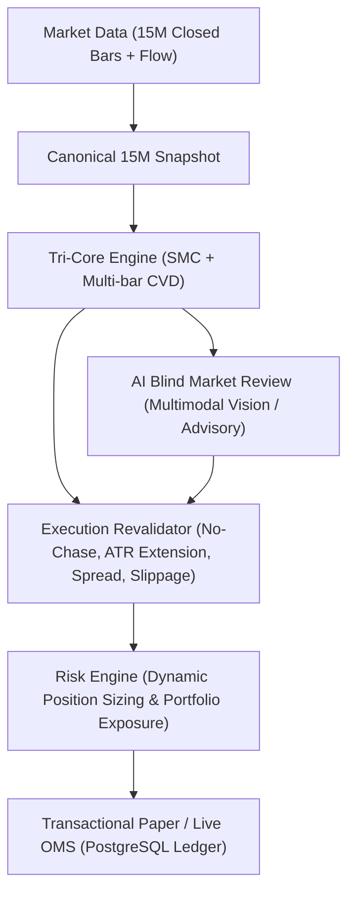

# AI Trade Advisor & Autonomous Execution Platform

> **Institutional-Grade Rule-Based & Advisory AI Trading System**  
> Operating on Deterministic Core Authorities, Canonical 15M Snapshots, Multi-bar Orderflow (SMC + CVD), Multimodal AI Blind Reviews, and Real-Time Risk Guardrails.

---

## 🏛️ System Architecture Overview

The platform is architected around strict **Authority Boundaries**:



### Core Authority Pipeline Sequence:
1. **Market Data & Canonical Snapshot (`15m`)**: Continuous feed processing with anti-repaint index confirmation. 4H/1H serve as context; execution binds strictly to the closed 15M bar.
2. **Tri-Core Engine**: Deterministic detection of SMC structures (BOS, CHoCH, OB, FVG, Liquidity Sweeps) + Multi-bar CVD absorption/divergence confirmation.
3. **Independent Multimodal AI Review**: Blind chart & context analysis providing second-opinion confirmation (`COHERENT`, `CAUTION`, `CONFLICT`). AI acts strictly as an advisory veto/safety gate and **cannot** alter entry, stop loss, take profit, or position size.
4. **Execution Revalidator**: Dynamic order routing (Market vs. Causal Limit Retest based on 0.25 ATR extension), ensuring strict R:R execution floors and quote freshness.
5. **Risk Engine**: Capital preservation guardrails enforcing dynamic position sizing, cluster correlation cooldowns, daily drawdown circuit breakers, and gross portfolio leverage limits.
6. **OMS (Order Management System)**: Transactional execution ledger with durable persistence, partial fills, auto-breakeven shields (+1.0R), and multi-tier trailing stops.

---

## 🚀 Key Features

* **Deterministic Authority**: All trade geometry, risk budget, and order lifecycle transitions are governed by deterministic Python algorithms.
* **Causal Orderflow Confirmation**: Single-bar delta spikes are disregarded; requires continuous multi-bar aggressor delta, absorption, or CVD divergence.
* **Range Boundary Protection**: Strict boundary entry validation for Ping-Pong setups; entries inside the Equilibrium (mid-range) zone are blocked unconditionally.
* **Dynamic Position Sizing**: Automatic position size reduction for structural ATR stops up to the 5.0% absolute circuit breaker ceiling:
  $$\text{Position Size} = \frac{\text{Account Balance} \times \text{Risk Per Trade \%}}{\text{Structural Stop Distance} + \text{Cost}}$$
* **Two-Way UI/Backend Sync**: Mobile and Web dashboards reflect real-time backend runtime configurations (`GET /api/v1/settings/runtime`), eliminating UI desynchronization.
* **Interactive SMC Charting**: Custom high-performance canvas rendering Order Blocks, Fair Value Gaps, Swing Breaks, Live Ticker Badges, and Volume MA 20.
* **Fail-Safe Live Gate**: Live execution requires cryptographic time-limited sessions (InnovestX/MT5) and production-certified walk-forward criteria. Auto-Pilot defaults to Paper simulation for capital preservation.

---

## 📁 Repository Structure

```text
ai_trade_advisor/
├── backend/
│   ├── app/
│   │   ├── api/             # FastAPI REST & WebSocket endpoints (signals, chart, settings, paper)
│   │   ├── core/            # Configuration contracts, settings, and runtime stores
│   │   ├── engines/         # Tri-Core, SMC, Risk, Strategy, Indicators, and Backtest engines
│   │   ├── models/          # SQLAlchemy async database models
│   │   └── services/        # EventTrigger, ExecutionRevalidator, CandidateLifecycle, DecisionTrace
│   ├── config/              # Strategy definitions (strategy.yaml) and runtime configs
│   ├── tests/               # Pytest test suite (100+ comprehensive integration & unit tests)
│   └── Dockerfile           # Backend containerization
├── mobile/                  # Flutter Client (Web, Android APK, iOS)
│   ├── lib/
│   │   ├── core/            # Theme, API client, trading panels, and state providers
│   │   └── features/        # Chart, Signals, Settings, Journal, and Apex AI screens
│   └── pubspec.yaml
├── docs/                    # Formal technical specifications & architecture blueprints
├── docker-compose.yml       # Orchestration for FastAPI, PostgreSQL, Redis, and Web
└── README.md
```

---

## 🛠️ Quick Start & Deployment

### 1. Requirements
- Docker & Docker Compose
- Python 3.12+ (for local development)
- Flutter 3.24+ (for mobile/web compilation)

### 2. Environment Setup
```bash
cp backend/.env.example backend/.env
# Configure your Binance, InnovestX, and LLM API keys in backend/.env
```

### 3. Launching with Docker
```bash
docker-compose up -d --build
```
- **Web App**: `http://localhost:3000`
- **Backend API & Swagger Docs**: `http://localhost:8000/docs`
- **PostgreSQL Database**: Port `5432`
- **Redis Cache**: Port `6379`

### 4. Running Backend Tests
```bash
docker exec ai_trade_backend pytest tests/
```

### 5. Compiling Flutter Artifacts
```bash
# Build Flutter Web Release
cd mobile
flutter build web --release

# Build Android Release APK
flutter build apk --release
# Artifact location: mobile/build/app/outputs/flutter-apk/app-release.apk
```

---

## 🛡️ Operational Safeguards

| Safety Layer | Deterministic Rule |
| :--- | :--- |
| **Daily Loss Limit** | Hard halt when cumulative intraday PnL drops $\le -3.0\%$ (configurable). |
| **Max Open Positions** | Rejects new executions when active trades reach configured threshold. |
| **Cluster Cooldown** | Pauses subsequent trades in the same direction and correlated asset group following a stop loss. |
| **No-Chase Policy** | If market price extends $> 0.25$ ATR beyond structural entry, orders automatically pivot to Causal Limit Retests. |
| **AI Veto Gate** | AI `CAUTION` or `CONFLICT` verdicts prevent order dispatch, setting status to `Stand Aside`. |
| **BTC Systemic Risk Anchor** | Halts Altcoin trade executions during BTC extreme volatility or directional divergence. |

---

## 📜 License & Compliance
This software is built for automated trade decision assistance and paper execution modeling. Real-money live executions must always be validated against regulatory rules and verified broker API connectors.
